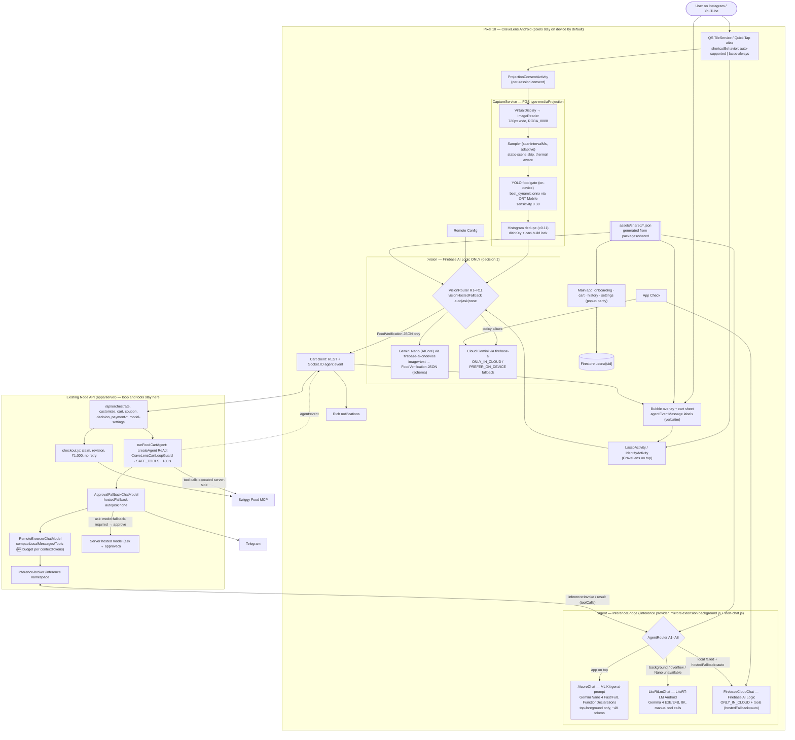

# CraveLens for Android: product and technical spec

> **For:** the Cursor coding agent building `apps/android`.
> **Target:** Firebase #BuildHybridAI hackathon. Submission deadline is **Nov 30, 2026, 2:00 PM PST (Dec 1, 3:30 AM IST)**.
> **Device:** Google Pixel 10, Android 16 (API 36). Kotlin, Jetpack Compose, single-activity Compose app plus overlay windows.
> **Repo:** `github.com/NishithP2004/CraveLens` (monorepo). Grounded in commit `140b795`.
> **Status legend:** ✅ verified in repo or docs · ⚠️ uncertain, verify in the day-one spike · 🆕 new work (does not exist yet)

Read `AGENTS.md` first. Its rules apply here too:
- No mock data in product flows.
- Frames stay on the device.
- Orders need explicit confirmation.
- `place_food_order` is never auto-retried.
- Docs ship with the feature.
- Tests go in `tests/` folders.

---

## 0. TL;DR

CraveLens Android is a Compose app with five parts:
1. A **foreground "watching" service**. It captures the screen through MediaProjection after per-session consent and runs the existing YOLO food detector (`best_dynamic.onnx`) on the device at about 1–2 fps.
2. **Dish identification through Firebase AI Logic hybrid inference (vision only).** Gemini Nano runs on the device through AICore and returns schema-shaped `FoodVerification` JSON. A cloud Gemini fallback is governed by explicit routing and privacy rules. The YOLO gate always runs first.
3. A **chat-head bubble** (an overlay) that is the app's main face. It shows live progress and expands into a bottom-sheet cart card over Instagram/YouTube.
4. **An on-device cart agent that mirrors the extension (§6.5).** The server keeps the ReAct loop, the Swiggy tools and the failure policy. The phone registers on the same `/inference` Socket.IO bridge the extension uses and answers each model turn with **Gemini Nano 4 function calling** (ML Kit `genai-prompt`). LiteRT-LM Gemma 4 is the secondary local runtime. Firebase AI Logic `ONLY_IN_CLOUD` with tools is the hosted fallback, under the same `hostedFallback` `auto|ask|none` semantics.
5. **Full feature parity with the Chrome extension** (parity map §3A, with the same settings names, defaults, prompts and wording), using the existing Node API unchanged wherever possible. That covers Swiggy OAuth, addresses, preferences and personal intelligence, cart edits, coupons, checkout (COD/UPI/Swiggy Money) with UPI status watching, Telegram, and history.

> ⚠️ **Most important platform fact (verified in the docs, 2026-11-12):** ML Kit/AICore on-device inference is allowed **only when the calling app is the top foreground app**. Calls made from a foreground service, or while another app is on top, fail with `ErrorCode.BACKGROUND_USE_BLOCKED` (code 30). The bubble overlay almost certainly does not count as "top".
>
> The design in §6 is built around this:
> - YOLO (our own runtime) runs in the background.
> - Gemini Nano runs whenever a CraveLens activity is on top: the lasso, a short translucent "Identify" activity, or the app itself.
> - Background identification goes to the cloud **only** if the user allows it.
> - The same rule hits the **cart agent**. Nano 4 answers bridge turns only while CraveLens is on top; in the background, LiteRT-LM (our own runtime) or the failure policy takes over (§6.3b).
> - The day-one spike (§14) must confirm this on the Pixel 10.

---

## 1. Overview and goals

### 1.1 Problem and pitch
You see food in a reel, and five seconds later a personalized, verified Swiggy cart floats over the reel, with nothing ordered until you confirm. The extension proved this works on desktop. Android is where reels are actually watched.

### 1.2 Goals
| # | Goal | Measure |
|---|---|---|
| G1 | Real-time food detection on the device while the user scrolls Instagram, YouTube or any app, with no sharing step | A cart nudge appears within 20 s p50 of a dish appearing (cart build time dominates) |
| G2 | Hybrid inference: on-device first, a visible cloud fallback, and a model badge on every result | Every identification shows `ON_DEVICE` or `IN_CLOUD` (from `response.inferenceSource`) plus the YOLO runtime |
| G3 | Full parity with the Chrome extension | All flows in §2 work against the production API |
| G4 | Safety parity: explicit confirmation, ₹1,000 limit, no order retries | Acceptance checklist §18 |
| G5 | Hackathon compliance | Firebase AI Logic is called at runtime, App Check is enforced, there's a public repo with a license, and the video is under 3 min |

### 1.3 Non-goals (decided by the user; do not build)
- Default digital-assistant role (`VoiceInteractionService`). The user doesn't want people to replace Gemini.
- Any **AccessibilityService** for screen reading or for automating other apps.
- A share-sheet flow.
- iOS (future work).
- Automatic ordering of any kind.

---

## 2. User flows

### 2.1 Onboarding and permissions (first run)
1. **Welcome** (3 cards): what CraveLens does, the privacy promise ("Frames never leave your phone unless you allow cloud help"), and the safety promise ("Nothing is ordered until you confirm").
2. **Device session.** Call `POST /api/device/session` and store `{deviceId, accessToken, accessExpiresAt, refreshToken, refreshExpiresAt}` (see §9.1).
3. **Firebase.** Sign in anonymously with Firebase Auth. App Check is installed before any Firebase AI Logic call.
4. **Connect Swiggy.** Call `POST /api/swiggy/auth/start`, which returns `{authorizationUrl, expiresAt}`, and open `authorizationUrl` in a **Custom Tab**. Poll `GET /api/swiggy/auth/status` every 1.2 s for up to 5 min; the result is `connected|pending|failed|missing`. This matches `apps/extension/src/oauth.js:waitForConnection` and needs no server change. The callback page `/api/swiggy/auth/callback` tells the user to "close this tab", so the app returns to the foreground on resume.
5. **Address.** Call `GET /api/swiggy/addresses` and pick one; store `addressId` and `addressLabel` (as the extension does).
6. **Preferences** (optional, can be skipped). There's a free-text dietary field (`personalContext`, ≤1000 chars) and a **"Build from my Swiggy history"** button that uses the personal-intelligence flow in §2.8.
7. **On-device model readiness.** Call `FirebaseAIOnDevice.checkStatus()`:
   - `DOWNLOADABLE`: show a download card, then `download().collect{}` with progress.
   - `AVAILABLE`: call `warmUp()` (§6.2).
   - `UNAVAILABLE`: explain that the cloud is the only path and set the vision consent to choice-only.
8. **Permissions**, each with a just-in-time rationale screen:
   - `POST_NOTIFICATIONS` (runtime permission).
   - "Display over other apps" through `Settings.ACTION_MANAGE_OVERLAY_PERMISSION` (a special access; check it with `Settings.canDrawOverlays`).
   - MediaProjection consent is **not** requested here. It's requested at the start of each watching session (required on Android 14+).
9. **When on-device identification can't run** (`visionHostedFallback`, the vision router, §6). The three options use the extension's wording, with **Ask before using a hosted model** selected by default:
   - Automatically use a hosted model (`auto`)
   - Ask before using a hosted model (`ask`)
   - Stop without switching models (`none`)

   The same screen also asks for the cart setting **When the local cart model fails** (`hostedFallback`, the same options, default `ask`), and shows the Nano 4 / AICore preview status (§2.8, 06).

   This mirrors `ModelSettingsSchema.hostedFallback` (`auto|ask|none`, default `ask`) in `packages/shared/src/index.js`.
10. **Add the Quick Settings tile** prompt (`StatusBarManager.requestAddTileService`, API 33+) and an optional **Quick Tap** setup guide (§7.6).

### 2.2 Watching session
1. The trigger is the in-app "Start watching" button, the QS tile, or the bubble.
2. A translucent `ProjectionConsentActivity` calls `MediaProjectionManager.createScreenCaptureIntent()`.
   - Recommend "Entire screen". "A single app" works, but then the lasso only works inside that app.
3. With the result, start `CaptureService` as a foreground service of type `mediaProjection` **before** calling `getMediaProjection()`. Then register a `MediaProjection.Callback` and create the `VirtualDisplay` (§5.2).
4. The persistent notification reads "CraveLens is watching for food · Stop". The system status-bar chip for screen sharing appears as well; that's expected.
5. The bubble appears (§2.3). The sampler runs YOLO (§6). On a gated hit, the vision router identifies the dish, and the app calls `POST /api/orchestrate`, follows progress over Socket.IO, and then shows the cart in the bubble or a notification.
6. The session stops in any of these cases:
   - the user taps Stop (in the notification, bubble menu, tile or app);
   - `MediaProjection.Callback.onStop` fires (the user revoked it from the status chip, or the screen locked);
   - 60 minutes of inactivity pass (Remote Config `watch_idle_timeout_min`).

   On stop, release the VirtualDisplay and ImageReader and remove the bubble unless a cart is pending.

### 2.3 Floating bubble (main face)
- **Collapsed state:** a 56 dp circular head with a status ring, draggable and snapping to edges, with drag-to-dismiss at a bottom "×" target.
  - The ring states are: `Watching` (idle, slow pulse), `Spotted food` (YOLO positive), `Identifying · On-device` or `Identifying · Cloud`, `Personalizing` (preferences/history tool events), `Preparing cart` (menu/cart/coupon tool events), `Cart ready ₹X` (badge), `Needs you` (fallback approval or follow-up question), `Paused` (an active cart is pending), and `Error`.
  - The label chip slides out next to the head for 3 s on each state change.
- **Tap while idle:** a radial mini-menu with **Lasso**, **Pause/Resume watching**, **Open app**, **Stop**.
- **Tap when the cart is ready:** expands to the **cart sheet** (§2.6) as a bottom-sheet overlay window. The app underneath stays resumed, so the reel keeps playing behind it.
- The status source is the Socket.IO `agent:event` stream, mapped as in §9.4.

### 2.4 Rich notification nudge
Used when the cart experience is "Notify me" (`cartExperience: "nudge"`), or when the overlay permission is missing.
- Channel `cart_ready`, importance DEFAULT, `BigPictureStyle` with `suggestion.imageUrl` (fetched with Coil) and the title "Looks delicious: {item} from {restaurant}".
  - The text is "₹{finalAmount} · ETA {deliveryEta} · {coupon or savings}".
  - The actions are **View cart** (opens the sheet or `CartActivity`) and **Not now** (dismisses locally only, keeping the cart).
  - **There is deliberately no "Order" action.** Ordering requires the review screen.
- ⚠️ On Android 16, an optional Live Update (promoted ongoing notification, `Notification.ProgressStyle`) shows "Preparing cart" progress as a status chip. It's nice-to-have; verify the API names (`setRequestPromotedOngoing`) on API 36.
- Rate limits come from Remote Config, and all of them are also enforced locally:
  - at most 1 cart nudge per 10 min (`nudge_min_interval_min=10`);
  - at most 4 per hour (`nudge_max_per_hour=4`);
  - quiet hours are off by default and user-settable.

  The server also enforces **one active cart per device** (`reserveBackgroundCart` in `apps/server/src/cart-experience.js`). A paused result (`code: "ACTIVE_CART_PENDING"`) becomes a "Paused · cart waiting" bubble state that offers to open `activeCart`.

### 2.5 Lasso (Google Lens-style)
- **Triggers:**
  1. Bubble → Lasso.
  2. QS tile long-press, or a tap when already watching.
  3. **Pixel Quick Tap** (double-tap on the back) set to "Open app → CraveLens Lasso", which is an `activity-alias` launcher entry (§7.6).
  4. An app shortcut (long-press the launcher icon → "Lasso").
- **Frame source:** the active capture session. On trigger, first call `FrameStore.freezeLatest()`, which grabs the latest `ImageReader` frame **before** any CraveLens UI is drawn, and only then launch `LassoActivity`. If there's no session, run the consent trampoline, grab a single frame after consent, and stop the projection afterwards unless the user picks "Keep watching".
- **UI:** a full-screen translucent `LassoActivity` (edge-to-edge) shows the frozen frame with an animated "neural" shader background (an `AGSL RuntimeShader` gradient-noise shimmer at the edges, API 33+), dimming everything except the lasso path.
  - The user draws a freehand path. On release, close the path, compute its bounding box, mask to the polygon (pixels outside become transparent, then white), crop, and scale so the longer side is at most 768 px.
  - Hints show "Circle the food" and "Tap anywhere to cancel". There's haptic feedback on close.
- **Pipeline:** a manual scan **skips the YOLO gate**, as in the extension ("manual scans bypass the detector gate", README). Because `LassoActivity` is the top foreground app, **Gemini Nano is allowed** (rules R1/R2, §6.3). Then comes the 0.65 gate, then orchestration. The activity shows the identification card with its model badge, then hands off to the bubble or cart sheet and finishes.

### 2.6 Cart and order (the "Looks delicious" sheet)
This is a parity port of the extension's receipt and cart shelf in `apps/extension/src/content.js` (render ~L1100–1700). The data is the `suggestion` object built in `apps/server/src/swiggy.js` (fields listed in §10.2).

The sheet shows:
- **Header:** restaurant logo (with a letter fallback), name, rating and count, location, and ETA.
- **Items:** image, name, quantity stepper, and price. The stepper calls `POST /api/orchestrate/:threadId/cart` with `{action:"set_quantity", itemId, quantity}`.
- **Add from menu:** `GET /api/orchestrate/:threadId/menu?q=` (q is at most 80 chars), then `{action:"add_item", itemId, itemName, selections[]}`.
- **Coupons:** the list from `availablePromos`. Selecting one calls `POST /api/orchestrate/:threadId/coupon {couponCode}`.
- **Receipt:** subtotal, discount, fees and charges, and **final payable** from `receipt` / `finalAmount`.
- **"Why this cart?":** `rationale`, `dietaryNotes`, `explanationSource`.
- **Ask CraveLens:** a free-text box (≤500 chars) that calls `POST /api/orchestrate/:threadId/customize {instruction, streamId, personalContext, timeZone}`. If the response includes `agentFollowUp` (an `AgentFollowUpSchema` form: radio, checkbox, select, text or textarea, at most 4 fields), render it as a native Compose form.
- **Model badges:** "Seen by: YOLO (on-device) → Gemini Nano (on-device)" or "→ Gemini (cloud)", plus "Cart by: {orchestration provider/model}" from `GET /api/model-settings`.
- **Big buttons**, each at least 64 dp tall and full width: **Order ₹X** and **Dismiss**. Dismiss collapses the sheet; a long-press or overflow on it offers **Reject cart**, which calls `/decision {decision:"reject"}`.

Order flow (strict):
1. If `cartLimitExceeded` is true (`finalAmount >= 1000`, `swiggy.js:726`), disable Order and show "Builders Club carts must be under ₹1,000". The server re-checks before ordering (`swiggy.js:78`, `:377`).
2. Tapping **Order** opens the payment chooser. It lists only methods where `paymentOptions[m].available` is true: `COD`, `UPI`, `SWIGGYPAY` (shown as "Swiggy Money"). This matches the `checkout.js` validation.
3. A **Confirm** step shows the final payable amount in large type and the address label. A press-and-hold for 600 ms prevents accidental orders.
4. Send `POST /api/orchestrate/:threadId/decision {decision:"approve", paymentMethod}` **exactly once**. The HTTP client for this call has `retryOnConnectionFailure(false)` and no interceptor retries (§9.1).
5. Handle the response `status`:
   - `ordered`: success screen, Firestore order mirror (§8.4), and a history entry.
   - `payment_pending`: `payment = {amount, upiString, bridgeUrl, expiresAt}` (`publicPayment`, `swiggy.js:449`). Launch `Intent(ACTION_VIEW, Uri.parse(upiString))` to open GPay, PhonePe or Paytm directly, which is an Android advantage over the desktop QR. Show a countdown to `expiresAt`. Poll `GET …/payment-status` every 3 s while the app or sheet is visible. On `paid`, call `POST …/confirm-payment`. Offer **Cancel payment process**, which calls `POST …/cancel-payment` (the server re-checks status first).
   - `payment_declined`: refresh `suggestion.paymentOptions` and ask again.
   - `payment_review_required`: show the server `message` and "Check the Swiggy app before trying again". **No retry button.**
   - 409 "This cart changed…": reload and re-review.
   - 410: the cart expired, so offer to rebuild.
6. On a network error or timeout during `/decision`, **do not retry**. Mark the thread as `uncertain` locally, disable Order, and query status through the new `GET /api/orchestrate/:threadId` (🆕 §9.5). Until that endpoint exists, tell the user to check Swiggy.

### 2.7 Order history (in-app)
- **Source of truth:** 🆕 `GET /api/orders` (§9.5). The server proxies Swiggy `get_food_orders` and `get_food_order_details`, which are read-only and already in `SAFE_TOOLS` (`apps/server/src/swiggy-agent.js:22`). This is needed because CraveLens threads have a **24 h TTL** in MongoDB (`apps/server/src/store.js`, `expireAfterSeconds: 86400`), so the server keeps no lasting history today.
- **Local and offline:** a Room cache, plus the Firestore mirror `users/{uid}/orders/{threadId}` written on `ordered` (CraveLens-placed orders only).
- **List rows:** dish image, restaurant, items, amount, date, payment method, status, and a "via CraveLens" badge with a model-path badge. Tapping a row opens details.

### 2.8 Settings (mirrors `apps/extension/src/popup.html` sections 01–06; labels verbatim)
The screen uses the extension's section names, field labels, keys and defaults (parity map §3A). The values are saved with **"Save settings →"**, as in the popup.

- **01 Personal context**
  - **Delivery address**: picker from `GET /api/swiggy/addresses`; stores `addressId` and `addressLabel`.
  - **Food preferences and routines** (`personalContext`, ≤1000 chars).
  - **History & evidence**: `POST /api/preferences/build {personalContext, addressId}` returns 202 `{runId…}`, then poll `GET /api/preferences/build/:runId` until the status is `ready`, `no_history` or `failed`. Show the `progress[]` messages, then the suggestion with **Use suggestion** / **Keep original**. The draft schema is `{preferences ≤1000, notes ≤1500}` (`preference-builder.js:16`). The build's model calls go over the `/inference` bridge (§6.5.7), so Nano runs it while Settings is on top.
  - 🆕 **Taste memory summary** (Android-only, text-only Nano through `genai-prompt`, foreground): it summarizes the last 30 confirmed dishes into "You've been craving…" (≤300 chars), and the user can accept it into `personalContext`.
- **02 Detection context**
  - Food sensitivity (`sensitivity`, default **0.38**).
  - Model scan interval (`scanIntervalMs`, bounds 1000–30000 like the extension; Android default **1000**, see §3A). The adaptive sampler (§6.1) may slow down further, but it never goes faster than the set value.
  - Keyboard shortcut behavior → **Tile & Quick Tap behavior** (`shortcutBehavior`: `auto-supported` = start or stop watching; `lasso-always` = open the lasso).
  - Debug overlay (`debug`, off); **Scan current frame** (in the bubble menu and here); **Reset detection defaults**.
- **03 VLM configuration**
  - **Frame verification model** (`vlm.provider`): `auto` "Auto · on-device first" (the default) or `gemini-nano` "Gemini Nano · Android built-in". Both run through Firebase AI Logic (decision 1).
  - 🆕 **When on-device identification can't run** (`visionHostedFallback`, Android-only and device-local): "Automatically use a hosted model" / "Ask before using a hosted model" (default) / "Stop without switching models". These are the same labels and `auto|ask|none` semantics as the cart setting, but they apply to the **frame crop** (pixels), so they're kept separate.
  - On-device model status and download (`FirebaseAIOnDevice.checkStatus()/download()`).
- **04 Agentic orchestration** (`GET/PUT /api/model-settings`, stored per device on the server, unchanged)
  - **Cart reasoning model** (`orchestration.provider`): `auto` "Auto · Gemini Nano 4 first" (the default; order `aicore` → `litert`); `aicore` "Gemini Nano 4 · on-device (AICore)"; `litert` "LiteRT Gemma 4 · on-device"; `openai-compatible` "OpenAI-compatible · remote"; `google` "Google Gemini · remote". Ollama isn't offered (§3A).
  - **Gemini Nano 4 model** (shown for aicore/auto): `gemini-nano-4-fast` "Nano 4 Fast · faster" (default) / `gemini-nano-4-full` "Nano 4 Full · stronger reasoning".
  - **LiteRT model** (shown for litert/auto): "Gemma 4 E2B · faster" (default) / "Gemma 4 E4B · stronger reasoning", plus download status.
  - **Context length** (`contextTokens`, default 16384, bounds 4096–32768). The device reports its real per-provider limit in `inference:register`; the server uses the smaller of the two (§9.5).
  - **Thinking mode** (`thinkingEnabled`, off). **Model name**, **OpenAI-compatible base URL**, **API key (write-only)**: the same fields and the same write-only credential handling.
  - **When the local cart model fails** (`hostedFallback`): "Automatically use a hosted model" / "Ask before using a hosted model" (default) / "Stop without switching models". These semantics are in §6.5.5.
- **05 Cart experience**
  - **While you watch** (`cartExperience`, `GET/PUT /api/cart-experience {mode, silent}`): "Show progress on screen" (`screen`, the bubble) / "Notify me when my cart is ready" (`nudge`) / "Send my cart to Telegram" (`telegram`).
  - **Connect Telegram** (`POST /api/telegram/connect` returns a Start link opened through a `tg:` intent; then `POST /api/telegram/confirm`; `DELETE /api/telegram`) and **Silent Telegram messages** (`telegramSilent`, off).
- **06 On-device AI setup** (the analogue of "Local AI setup"): AICore Developer Preview enrollment status (whether "Gemini Nano 4 Fast" is listed in the AICore app), the Nano download, the optional LiteRT-LM Gemma 4 download (≈2.5 GB ⚠️), and which provider answered the last turn.
- **Account / About:** Swiggy connect and disconnect (`DELETE /api/swiggy/auth`), Sign out (`POST /api/device/session/revoke`), theme (`themeMode` system/light/dark), the Dev environment toggle (debug builds only), the privacy policy, licenses and version.

---

## 3. Architecture



**Trust boundaries (same as the extension):**
- The server receives only `FoodVerification` JSON, `addressId`, source metadata and `personalContext`. It never receives pixels.
- Pixels go to Google cloud Gemini only through Firebase AI Logic, and only when `visionHostedFallback` allows it.
- The cart model (on the phone or in the cloud) only **proposes** tool calls. The server executes them against Swiggy with `SAFE_TOOLS`. Swiggy tokens never reach the phone, and `place_food_order` is never offered to the model.

---

## 3A. Parity map: extension -> Android

**Rule:** when the extension already does something, Android does the same thing, with the same name, default, threshold, wording and error code. Android-only differences must be listed in the "Gap" column. "Verbatim" means the text or value comes from the shared export (§4.1), not from a copy someone typed by hand.

| Extension file | Android class / package | Reused verbatim | Gap / Android difference |
|---|---|---|---|
| `packages/shared/src/index.js` (Zod schemas) | `:core` `core.model.*` (`@Serializable` data classes, §10), generated or checked against `shared-schemas.json` (§4.1) | Field names, enums, limits: `FoodVerificationSchema`, `OrchestrateRequestSchema`, `ModelSettingsSchema`, `InferenceRequestSchema`/`InferenceResultSchema`, `CartMutationSchema`, `AgentFollowUpSchema` | 🆕 `aicore` added to `InferenceProviderSchema` and `OrchestrationProviderSchema` |
| `background.js` defaults (L11) and `popup.js` defaults | `PrefsRepository` (DataStore) + `ModelSettingsRepository` | Keys and defaults: `enabled:true`, `debug:false`, `sensitivity:0.38`, `scanIntervalMs` (bounds 1000–30000), `shortcutBehavior` (`auto-supported`/`lasso-always`), `personalContext:""`, `addressId`, `addressLabel`, `cartExperience:"screen"`, `telegramSilent:false`, `themeMode:"system"`, `hostedFallback:"ask"`, `contextTokens:16384` (4096–32768), `thinkingEnabled:false` | `scanIntervalMs` default is **1000** on Android, not 4000: reels must be sampled at about 1 fps (the user's own sampling decision). `autoDetectYouTube/Instagram/Facebook` can't map (we can't tell which app is on screen without Accessibility or UsageStats); the analogue is MediaProjection "single app" vs "entire screen" |
| `popup.html` / `popup.js` (sections 01–06) | `ui/settings/*` (§2.8) | Section names and labels: "Personal context", "Detection context", "VLM configuration", "Agentic orchestration", "Cart experience", "Local AI setup"; "Delivery address", "Food preferences and routines", "History & evidence", "Use suggestion", "Keep original", "Frame verification model", "Cart reasoning model", "LiteRT model", "Context length", "Thinking mode", "When the local cart model fails" plus its 3 options, "While you watch" plus its 3 options, "Connect Telegram", "Silent Telegram messages", "Save settings →", "Reset detection defaults", "Scan current frame" | Option lists differ where the runtime differs (see the next rows). The 12B/26B/31B models aren't offered on a phone. The "Local AI setup" text describes AICore and LiteRT-LM instead of WebGPU/Ollama |
| `background.js` `runConfiguredVerification` (VLM providers: auto → Gemini Nano → Gemma 3n → Ollama) | `:vision` `VisionRouter` + `AiLogicModels` (§6.2–6.3) | `VlmProviderSchema` values `auto` and `gemini-nano`; `VLM_CONTEXT_TOKENS = 4096` with an output reserve; the same prompt (`foodVerificationInstruction`) | **Decision 1: vision uses Firebase AI Logic only** (Gemini Nano on device, plus the Firebase cloud model). Gemma 3n/Ollama vision aren't offered. Android adds a cloud step the extension doesn't have, governed by `visionHostedFallback` with the same `auto|ask|none` semantics |
| `food-verification.js` (`foodVerificationInstruction`, `parseVerification`) + `detector.js` (`frameFeatures`, `selectKeyframe`) | `vision/VerificationPrompt.kt`, `VerificationParser.kt`, `FrameFeatures.kt` | The prompt text, the parsing rules (first `{…}`, enum checks, confidence clamp, ≤8 dishes), and the keyframe thresholds | The on-device variant appends the 3-dish suffix (§6.4). The title is "Android screen" and there's no transcript text |
| `offscreen.js` `runDetection` + `food-worker.js` (YOLO) | `vision/Letterbox.kt`, `YoloDecode.kt`, `OrtFoodDetector.kt` | 640 letterbox, `rgb(114,114,114)`, ÷255 CHW, decoder layouts, IoU NMS 0.45, max 25 boxes, `best_dynamic.onnx` (copied at build time) | ORT Mobile instead of onnxruntime-web |
| `content.js` (video sampling, dedupe, lasso, shelf, nudge, agent status) | `capture/*`, `overlay/*`, `lasso/*`, `notify/*` | The histogram dedupe `< 0.11`, `foodCravingIdentity` + `dishKey`, the `agentEventMessage` strings (§9.4, copied verbatim from `content.js:381–412`), "Why this cart?", "Cart ready from {restaurant}" | A screen-wide capture and a floating bubble instead of the in-page shelf. A freehand lasso instead of a rectangle. A tile and Quick Tap instead of the keyboard shortcut. "Scan current frame" becomes "Scan now" on the bubble menu (YOLO skipped, as in the extension) |
| `cart-flow.js` (`withCartProgress`, `cartPreparationNotice`) | `data/CartRepository.kt` | The order connect-subscribe → prepare → disconnect, and the notice text | — |
| `transcript.js` (YouTube captions as VLM context) | — | — | **Gap:** we can't read another app's captions without Accessibility (a non-goal). The prompt gets "No transcript context was available." |
| `ollama-chat.js` (Ollama VLM and cart provider) | — | — | **Gap:** there's no Ollama on the phone. Optional later: LAN Ollama with the same `OllamaBaseUrlSchema` (cleartext would need a network-security exception) |
| `debug-vlm.js` + the debug overlay | `ui/debug/*` | `debug` flag semantics | Adds the per-turn agent `metrics.runtime` log |
| `cart-build-lock.js` | `core/CartBuildLock.kt` | Same key (source + dishKey) and the same semantics | — |
| `oauth.js` `waitForConnection` | `data/SessionRepository` | Polling every 1.2 s for 5 min, and the `connected/pending/failed/missing` handling | A Custom Tab instead of `chrome.tabs` |
| `background.js` `connectInferenceSocket` (the `/inference` bridge) | `:agent` `InferenceBridge` (§6.5) | Namespace, auth, `inference:register` payload shape, 25 s heartbeat, `inference:invoke`/`cancel`/`chunk`, ack shape | Provider ids `aicore` + `litert` (Android model files) |
| `litert-chat.js` (`runLiteRtConversation`, `liteRtToolPolicy`, `toLiteRtMessages`, `trimOldestExchange`) | `agent/AicoreChat.kt`, `LiteRtLmChat.kt`, `ToolPolicy.kt`, `ContextTrimmer.kt`, `MessageMapper.kt` | Tool names and schemas (they come from the server request; nothing is hard-coded), the "CURRENT TURN:" policy text, `finishReason` values, `INFERENCE_*` codes, `LITERT_MAX_OUTPUT_TOKENS = 1536` | No constrained decoding on Nano, so near-miss name repair is added. The context is ~4K on Nano vs 16K |
| `litert-models.js` (`LITERT_TEXT_MODELS`) | `agent/LiteRtModels.kt` | Model ids for E2B/E4B and the "faster"/"stronger reasoning" labels | Android `.litertlm` URLs; the downloads go to app-private storage |
| Server `approval-fallback-chat-model.js` + `fallback-approval.js` | Unchanged server code. Android implements `ask` through §7.3 and `auto` through `FirebaseCloudChat` | `hostedFallback` semantics, the 120 s TTL, `POST /api/orchestrate/:runId/fallback`, and the event wording | For `auto`, the hosted call runs through Firebase AI Logic on the device instead of server-side Gemini/OpenAI |
| Server `swiggy-agent.js` (system prompt, `SAFE_TOOLS`, loop guard) | **Not ported.** It stays on the server | Everything | 🆕 A compact prompt variant for small contexts (§6.5.4) |
| `popup.js` Telegram, cart experience, preferences build | `ui/settings/*`, `data/*` | Endpoints and modes `screen`/`nudge`/`telegram` | Telegram opens through a `tg:` intent |
| Checkout UI in `content.js` (chooser, UPI QR, status) | `ui/cart/Checkout*` | Endpoints, the ₹1,000 limit, no retry of `/decision`, status strings | A direct UPI intent instead of a QR code |
| `theme.js` | `ui/theme` | `themeMode` `system/light/dark`, and the brand colors | — |
| Dev environment toggle (`environment`: development vs production) | Build flavor plus a debug-only toggle | The same two environments and base URLs | — |

---

## 4. Module and package layout

The Android code lives at `apps/android/`. It's a Gradle project inside the npm monorepo and is not an npm workspace. Add `apps/android/**/build`, `.gradle`, `local.properties` and `google-services.json` to `.gitignore`.

```text
apps/android/
├── settings.gradle.kts, build.gradle.kts, gradle/libs.versions.toml
├── README.md 🆕                  # build, Firebase setup, device setup
├── app/                         # :app — Application, DI, navigation, manifest
│   └── src/main/java/page/nishithp/cravelens/
│       ├── CraveLensApp.kt              # Firebase init, App Check provider, Remote Config defaults
│       ├── MainActivity.kt              # Compose NavHost
│       ├── ui/onboarding/  ui/cart/  ui/history/  ui/settings/  ui/theme/
│       ├── capture/
│       │   ├── CaptureService.kt        # FGS mediaProjection; owns VirtualDisplay/ImageReader
│       │   ├── ProjectionConsentActivity.kt
│       │   ├── FrameStore.kt            # timestamped ring buffer (~2 s), freezeLatest()
│       │   └── AdaptiveSampler.kt
│       ├── overlay/
│       │   ├── BubbleController.kt      # WindowManager windows, drag/snap/dismiss
│       │   ├── OverlayLifecycleOwner.kt # Lifecycle+SavedState+ViewModelStore for ComposeView
│       │   ├── BubbleUi.kt  CartSheetOverlay.kt
│       ├── lasso/  LassoActivity.kt  NeuralShader.kt (AGSL)  LassoCrop.kt
│       ├── identify/ IdentifyActivity.kt  # translucent foreground hop for Nano
│       ├── tile/   CraveTileService.kt
│       ├── notify/ Notifier.kt  NudgeRateLimiter.kt
│       └── data/   SessionRepository.kt  CartRepository.kt  PrefsRepository.kt  HistoryRepository.kt
├── vision/                      # :vision — no Android UI
│   └── src/main/java/page/nishithp/cravelens/vision/
│       ├── FoodDetector.kt              # interface; OrtFoodDetector.kt (default), LiteRtFoodDetector.kt (stretch)
│       ├── YoloDecode.kt                # port of apps/extension/src/food-worker.js decodeOutput + IoU NMS 0.45
│       ├── Letterbox.kt                 # 640x640, CHW float32
│       ├── FrameFeatures.kt             # port of food-verification.js frameFeatures/selectKeyframe
│       ├── VisionRouter.kt              # §6.3 rules
│       ├── AiLogicModels.kt             # GenerativeModel instances per mode
│       ├── VerificationPrompt.kt        # from Remote Config, default = shared prompt
│       └── VerificationParser.kt        # port of parseVerification + schema validation
│   └── src/main/assets/models/food-detector/best_dynamic.onnx   # copied at build time from apps/extension/public/models (do not duplicate in git)
├── agent/                       # :agent — /inference bridge provider (§6.5); no UI
│   └── src/main/java/page/nishithp/cravelens/agent/
│       ├── InferenceBridge.kt           # socket.io /inference: register, heartbeat 25 s, invoke/cancel/chunk (port of background.js connectInferenceSocket)
│       ├── AgentRouter.kt               # §6.3b A1–A8
│       ├── AicoreChat.kt                # ML Kit genai-prompt, Gemini Nano 4, FunctionDeclarations (port of litert-chat.js)
│       ├── LiteRtLmChat.kt  LiteRtModels.kt  # LiteRT-LM Android, Gemma 4 E2B/E4B, manual tool calls
│       ├── FirebaseCloudChat.kt         # Firebase AI Logic ONLY_IN_CLOUD + tools (hostedFallback=auto)
│       ├── MessageMapper.kt  ToolSchemaMapper.kt  ToolPolicy.kt  ContextTrimmer.kt  NearMissToolNames.kt
│       └── InferenceErrors.kt           # INFERENCE_* codes from shared constants.json
└── core/                        # :core — pure Kotlin + network
    └── src/main/java/page/nishithp/cravelens/core/
        ├── model/  (kotlinx.serialization mirrors of packages/shared, §10)
        ├── api/    CraveLensApi.kt (Retrofit), AuthInterceptor.kt, TokenRefresher.kt (Mutex), NoRetryClient.kt
        ├── events/ AgentEventSocket.kt (socket.io-client)
        └── identity/ FoodCravingIdentity.kt (port of foodCravingIdentity)
```

> **Package name assumption:** `page.nishithp.cravelens`. Confirm before creating the Firebase app, because it can't change afterward without re-registering.

**Shared-logic story:** see §4.1. The prompts, schemas, thresholds and labels are defined once in `packages/shared` and exported as JSON and Remote Config defaults at build time.

**Key dependencies** (pin the versions in `libs.versions.toml`; ⚠️ re-check them on the day):
- `com.google.firebase:firebase-bom` (≥34.10.0); `firebase-ai` (docs show 18.2.0); `com.google.firebase:firebase-ai-ondevice:16.0.0-beta08` (**not in the BoM**, requires minSdk 26); `firebase-appcheck-playintegrity`; `firebase-appcheck-debug` (debug only); `firebase-auth`, `firebase-firestore`, `firebase-config`.
- `com.microsoft.onnxruntime:onnxruntime-android` (YOLO, default), or `com.google.ai.edge.litert:litert` plus the GPU delegate (stretch).
- Retrofit/OkHttp, kotlinx.serialization, `io.socket:socket.io-client` 2.x, Coil 3, Room, DataStore, `androidx.browser` (Custom Tabs), Hilt (optional; manual DI is fine).
- `com.google.mlkit:genai-prompt:1.0.0-beta5` and `com.google.mlkit:genai-schema:1.0.0-alpha2` (Nano 4 function calling; **Kotlin ≥ 2.3.0**, and the AICore Developer Preview on the device).
- `com.google.ai.edge.litertlm:litertlm-android` (secondary agent runtime, ⚠️ latest version).
- `minSdk 26` (forced by `firebase-ai-ondevice` and ML Kit GenAI), `targetSdk 36`, `compileSdk 36`.

### 4.1 Shared prompts, schemas and constants (single source of truth, no drift)
Everything Android reuses "verbatim" is **generated from `packages/shared` at build time**. Nobody copies it by hand.

1. 🆕 `packages/shared/src/prompts.js` exports:
   - `foodVerificationInstruction` (moved from `food-verification.js`)
   - the Android 3-dish suffix
   - `CART_AGENT_SYSTEM_PROMPT` (moved from `swiggy-agent.js:279`) and 🆕 `CART_AGENT_SYSTEM_PROMPT_COMPACT`
   - the `liteRtToolPolicy` "CURRENT TURN:" templates
   - the `agentEventMessage` label table (moved from `content.js:381`)

   The extension, the server and the export script all import these.
2. 🆕 `packages/shared/src/constants.js` exports the thresholds and defaults currently scattered across `popup.js`, `content.js`, `background.js` and `food-worker.js`. That covers `DEFAULT_SENSITIVITY`, `DEFAULT_SCAN_INTERVAL_MS`, scan bounds, `DEDUPE_DISTANCE = 0.11`, `NMS_IOU = 0.45`, `FOOD_CONFIDENCE_GATE = 0.65`, `VLM_CONTEXT_TOKENS = 4096`, `LITERT_MAX_OUTPUT_TOKENS = 1536`, `DEFAULT_LOCAL_CONTEXT_TOKENS`, the `INFERENCE_*` codes and the `finishReason` values.
3. 🆕 `scripts/export-shared.mjs` (run by `npm run export:android` and by a Gradle `preBuild` task through `node`) writes:
   - `apps/android/core/src/main/assets/shared/prompts.json`, `constants.json` and `labels.json`
   - `shared-schemas.json`: JSON Schema produced from the Zod schemas with `zod-to-json-schema` ⚠️ (add as a devDependency)
   - `apps/android/app/src/main/res/xml/remote_config_defaults.xml` and `firebase/remoteconfig.template.json` (the vision prompt and thresholds, §8.3)
4. **Kotlin side:**
   - `core.shared.SharedAssets` loads the JSON.
   - The `@Serializable` data classes (§10) stay hand-written for readability, but `SharedSchemaParityTest` (a JVM unit test) compares every class's fields, enums and limits against `shared-schemas.json`, and fails the build when they drift.
5. **CI:** `npm test` checks that the generated files are up to date (`git diff --exit-code` after the export). The JS tests keep importing the same constants, so changing a value in one place changes it on every platform.
6. **Tool names and tool schemas are never stored on Android.** They come in each `inference:invoke` request from the server (`SAFE_TOOLS` + `liteRtToolSchema`), exactly as in the extension.

---

## 5. Key Android components

### 5.1 Manifest (essentials)
```xml
<uses-permission android:name="android.permission.INTERNET"/>
<uses-permission android:name="android.permission.POST_NOTIFICATIONS"/>
<uses-permission android:name="android.permission.FOREGROUND_SERVICE"/>
<uses-permission android:name="android.permission.FOREGROUND_SERVICE_MEDIA_PROJECTION"/>
<uses-permission android:name="android.permission.SYSTEM_ALERT_WINDOW"/>
<uses-permission android:name="android.permission.VIBRATE"/>
<!-- shortService FGS type needs no extra permission. ⚠️ Android 16 Live Updates (optional): verify android.permission.POST_PROMOTED_NOTIFICATIONS -->

<queries> <!-- package visibility for UPI and Telegram apps -->
  <intent><action android:name="android.intent.action.VIEW"/><data android:scheme="upi"/></intent>
  <intent><action android:name="android.intent.action.VIEW"/><data android:scheme="tg"/></intent>
</queries>

<application android:name=".CraveLensApp" ...>
  <activity android:name=".MainActivity" android:exported="true"><!-- MAIN/LAUNCHER --></activity>

  <activity android:name=".lasso.LassoActivity" android:exported="false"
      android:theme="@style/Theme.CraveLens.Translucent" android:excludeFromRecents="true"
      android:taskAffinity="page.nishithp.cravelens.lasso" android:launchMode="singleTask"/>
  <!-- Separate launcher entry so Pixel Quick Tap ("Open app") can target the lasso directly. ⚠️ verify it appears in the Quick Tap picker -->
  <activity-alias android:name=".LassoLauncher" android:targetActivity=".lasso.LassoActivity"
      android:label="CraveLens Lasso" android:icon="@mipmap/ic_lasso" android:exported="true">
    <intent-filter><action android:name="android.intent.action.MAIN"/><category android:name="android.intent.category.LAUNCHER"/></intent-filter>
  </activity-alias>

  <activity android:name=".capture.ProjectionConsentActivity" android:exported="false"
      android:theme="@style/Theme.CraveLens.Translucent" android:excludeFromRecents="true"/>
  <activity android:name=".identify.IdentifyActivity" android:exported="false"
      android:theme="@style/Theme.CraveLens.Translucent" android:excludeFromRecents="true"
      android:taskAffinity="page.nishithp.cravelens.identify"/>

  <service android:name=".capture.CaptureService" android:exported="false"
      android:foregroundServiceType="mediaProjection|shortService"/>
  <service android:name=".tile.CraveTileService" android:exported="true"
      android:icon="@drawable/ic_tile" android:label="CraveLens"
      android:permission="android.permission.BIND_QUICK_SETTINGS_TILE">
    <intent-filter><action android:name="android.service.quicksettings.action.QS_TILE"/></intent-filter>
    <meta-data android:name="android.service.quicksettings.TOGGLEABLE_TILE" android:value="true"/>
  </service>
</application>
```
App shortcuts (`res/xml/shortcuts.xml`): **Lasso** and **Start watching**.

### 5.2 `CaptureService` (FGS type `mediaProjection`)
- Start it with `startForegroundService` from `ProjectionConsentActivity` after `RESULT_OK`. In `onStartCommand`, call `startForeground(id, notif, ServiceInfo.FOREGROUND_SERVICE_TYPE_MEDIA_PROJECTION)` **first**, then `getMediaProjection(resultCode, data)`.
- The consent token is **single-use**. Never cache the `Intent` across sessions (Android 14+).
- Call `projection.registerCallback(callback, handler)` **before** `createVirtualDisplay(...)`, which is required on API 34+. `onStop` tears everything down.
- `VirtualDisplay` uses the screen aspect ratio at **width 720** (on the Pixel 10 that's about 720×1616), with `ImageReader.newInstance(w, h, PixelFormat.RGBA_8888, maxImages=3)`. Handle `onCapturedContentResize` (API 34) by recreating the reader. Also handle rotation.
- The sampler pulls with `acquireLatestImage()` on a dedicated `HandlerThread`. It copies into a pooled `Bitmap` (handle row padding), stores it in `FrameStore` with a timestamp, then closes the `Image` immediately.
- The service owns a `CoroutineScope(SupervisorJob() + Dispatchers.Default)` for YOLO, routing and the cart client.
- **Post-stop cart builds:** if the user stops watching while a cart is building, keep the service in the foreground by re-calling `startForeground` with type `shortService` (3 min limit). On `onTimeout`, post the result notification and stop. ⚠️ Verify that switching type works without a new start; otherwise start a second `CartBuildService` (shortService).
- **Battery saver or thermal:** listen to `PowerManager.addThermalStatusListener`. At `THERMAL_STATUS_MODERATE` or higher, use 0.5 fps. At `SEVERE` or higher, pause and show the bubble as "Paused (phone is hot)".

### 5.3 Overlay: bubble and sheet
- Two windows, both `TYPE_APPLICATION_OVERLAY`:
  - **Head:** `WRAP_CONTENT`, `FLAG_NOT_FOCUSABLE | FLAG_LAYOUT_NO_LIMITS`, gravity TOP|START, moved by updating `x/y`.
  - **Sheet:** `MATCH_PARENT` width, bottom-anchored, height = content (at most 75% of the screen). Clear `FLAG_NOT_FOCUSABLE` while it's expanded so the IME works for "Ask CraveLens", and set `SOFT_INPUT_ADJUST_RESIZE`.
- **Scrim:** a separate full-screen window at alpha **≤ 0.6**. Tapping it collapses the sheet. Android 12+ blocks touch pass-through for untrusted overlays above 0.8 opacity, but the scrim consumes touches anyway, so this is fine.
- Compose inside a `ComposeView` needs `setViewTreeLifecycleOwner`, `setViewTreeSavedStateRegistryOwner` and `setViewTreeViewModelStoreOwner`. Implement these in `OverlayLifecycleOwner` and drive it from the service lifecycle.
- **Excluding our own UI from the capture:** set `WindowManager.LayoutParams.FLAG_SECURE` on all overlay windows so they show up black in the MediaProjection output. Also mask the head's last-known rect before YOLO. ⚠️ Verify that FLAG_SECURE applies to `TYPE_APPLICATION_OVERLAY` on API 36. If it doesn't, rely on rect masking and hide the head for one frame during `freezeLatest()`.
- **Alternative considered:** the Android Bubbles API (`Notification.BubbleMetadata`). It was rejected because it needs conversation shortcuts or messaging semantics, which don't fit food nudges.

### 5.4 `CraveTileService`
- `onStartListening`: set `qsTile.state` to `STATE_ACTIVE` ("Watching") or `STATE_INACTIVE` ("Off"), and `subtitle` to "Watching", "Off" or "Cart ready".
- `onClick`:
  - **If not watching:** `startActivityAndCollapse(PendingIntent)` to `ProjectionConsentActivity`. On API 34+, the `PendingIntent` overload is **mandatory**; the `Intent` overload throws.
  - **If watching:** `FrameStore.freezeLatest()` first, then `startActivityAndCollapse(PendingIntent → LassoActivity)`.

  Toggling off is done through the bubble menu or the notification Stop action. ⚠️ Decide whether a tile tap while watching means "Lasso" (the recommended default) or "Stop", and make it a setting.
- Prompt to add the tile with `StatusBarManager.requestAddTileService(component, label, icon, executor, callback)` once, after onboarding.

### 5.5 `IdentifyActivity` (foreground hop for Nano)
- A translucent, no-animation activity with a 96 dp card at the bottom: "Identifying on-device…" with the Nano badge and shimmer.
- It runs `nanoOnly.generateContent(...)` on the held crop, writes the result to `VisionResultBus`, and calls `finish()`. The Instagram activity underneath gets `onPause` (it stays visible). ⚠️ Instagram may pause the reel while paused, so measure this in the spike.
- It's launched only after an explicit **user tap** on the bubble ("Spotted food · Tap to identify on-device"). The tap on our own overlay window is a user interaction, so starting the activity is allowed. ⚠️ Still, launch only on a user tap and never automatically, both for UX and for background-activity-launch policy reasons.

### 5.6 `LassoActivity`
- It reads the frozen frame from `FrameStore`. If the frame is null and no session is active, it runs `ProjectionConsentActivity` for a result in "single frame" mode.
- Freehand input uses `Modifier.pointerInput` to build a `Path`. Simplify it (Ramer–Douglas–Peucker, ε = 2 px) and close it.
- The crop is the polygon bounding box. It's then masked, letterboxed for display, and scaled to max side 768 for the VLM.
- Because the activity is on top, the router chooses `PREFER_ON_DEVICE` when consent is `auto`, and `ONLY_ON_DEVICE` followed by an explicit "Try in cloud?" prompt when consent is `ask` (§6.3).

---

## 6. Inference pipeline and routing rules

### 6.1 Pipeline
```text
Frame (720w RGBA) ──► static-scene skip ──► mask own overlays ──► letterbox 640 ──► YOLO
   └ if maxScore ≥ yolo_threshold (0.38): burst 3 frames over ~600 ms ──► selectKeyframe (density<0.11, then sharpness)
       └ histogram dedupe vs session foodHistory (L1 distance < 0.11 → skip)          [content.js:146]
           └ crop = union of YOLO boxes (+12% pad), max side 768  (full frame if boxes cover >60%)
               └ VisionRouter ─► FoodVerification JSON ─► gate: isFood && confidence ≥ 0.65 [app.js /api/orchestrate]
                   └ dishKey = hash(foodCravingIdentity(v), addressId, personalContext)     [content.js:222]
                       └ cart-build lock (per source+dishKey, cart-build-lock.js) ─► POST /api/orchestrate
```
- **YOLO details (port of `apps/extension/src/food-worker.js`):**
  - Input is `[1,3,640,640]` float32 CHW RGB, normalized to 0..1 (÷255), letterboxed and centred with fill `rgb(114,114,114)`; keep `{scale, x, y}` for mapping back. ✅ This matches `apps/extension/src/offscreen.js` `runDetection`.
  - Output is `[1,5,8400]`, channel-first: cx, cy, w, h, score. The decoder handles both layouts, as `decodeOutput` does.
  - Score ≥ threshold, then sort, then IoU NMS 0.45, keeping at most 25 boxes.
  - Map the boxes back through the letterbox transform.
- **Static-scene skip:** if the 24-bin histogram L1 distance to the last sampled frame is under 0.03 **and** the last YOLO run was negative, skip YOLO. This saves most of the battery cost while the user is reading captions.
- **Adaptive rate:** `base = 1 fps`.
  - Switch to 2 fps for 5 s when `0.25 ≤ score < threshold` (food is likely coming).
  - Drop to 0.5 fps after 20 s of negatives.
  - Cap at 0.5 fps when thermal status is `MODERATE` or higher, or battery saver is on.
  - Stop entirely while the screen is off.
- **Cooldowns:**
  - The same `dishKey` is ignored for the rest of the session.
  - After a cart is built, YOLO-to-VLM escalation pauses for `vlm_cooldown_after_cart_s = 120`.
  - VLM calls are limited to `vlm_max_per_min = 6`, which protects the AICore quota.
- **Source metadata for `/api/orchestrate`:**
  - `videoId` must match `^[\w-]{6,20}$` (`OrchestrateRequestSchema`). Use `"and-" + base36(sessionId).take(12)`, generated per watching session (real, not mock), or a lasso id for lasso scans.
  - `timestamp` = seconds since the session started.
  - `triggerConfidence` = the YOLO max score, or 1.0 for lasso.
  - `videoTitle` = "Android screen" or "Android lasso". We don't read other apps' titles (no Accessibility, no UsageStats).
  - `location` = the address label; `timeZone` = `ZoneId.systemDefault().id`; `streamId` = a fresh UUID per run.

### 6.2 Firebase AI Logic model instances
✅ The API names come from firebase.google.com/docs/ai-logic/hybrid/android/get-started and /configuration-options, both last updated 2026-11-12.

```kotlin
@OptIn(PublicPreviewAPI::class)
object AiLogicModels {
    private val ai = Firebase.ai(backend = GenerativeBackend.googleAI())          // Gemini Developer API
    private val cloudModel get() = remoteConfig.getString("vision_cloud_model")  // default "gemini-3.5-flash-lite" ⚠️ confirm name
    private fun onDevice(mode: InferenceMode) = OnDeviceConfig(
        mode = mode,
        maxOutputTokens = 384,                     // docs advise <256 output tokens; see 6.4
        temperature = 0.1f,
        modelOption = OnDeviceModelOption.valueOf(remoteConfig.getString("ondevice_model_option")) // STABLE default; PREVIEW / PREVIEW_FAST need AICore Developer Preview ⚠️
    )
    // The cloud model name is required for PREFER_ON_DEVICE / PREFER_IN_CLOUD / ONLY_IN_CLOUD (the SDK has no default).
    val nanoOnly  = ai.generativeModel(modelName = cloudModel, generationConfig = jsonConfig, onDeviceConfig = onDevice(InferenceMode.ONLY_ON_DEVICE))
    val hybrid    = ai.generativeModel(modelName = cloudModel, generationConfig = jsonConfig, onDeviceConfig = onDevice(InferenceMode.PREFER_ON_DEVICE))
    val cloudOnly = ai.generativeModel(modelName = cloudModel, generationConfig = jsonConfig, onDeviceConfig = onDevice(InferenceMode.ONLY_IN_CLOUD))
}
// call:
val response = model.generateContent(content { image(bitmap); text(prompt) })
val source = response.inferenceSource   // ON_DEVICE | IN_CLOUD  → model badge
```
- The config is fixed for the instance's lifetime, so rebuild the instances when Remote Config activates new values.
- Readiness uses `FirebaseAIOnDevice.checkStatus()` (`UNAVAILABLE|DOWNLOADABLE|DOWNLOADING|AVAILABLE`), `FirebaseAIOnDevice.download(): Flow<DownloadStatus>` (`DownloadStarted|DownloadInProgress|DownloadCompleted|DownloadFailed`), and `warmUp()`.
  - ⚠️ The docs show `onDeviceExtension?.warmUp()` without naming the receiver, so find it in the SDK.
  - Call `warmUp()` when the watching session starts while the app is in the foreground, when `LassoActivity` is created, and when `IdentifyActivity` is created.
  - The SDK does **not** auto-download the model on a request, so download it during onboarding.
- Structured output: set `jsonConfig = generationConfig { responseMimeType = "application/json"; responseSchema = foodVerificationSchema }`.
  - ⚠️ It's unclear whether on-device honors `responseSchema` passed in `generationConfig` (the docs say on-device "supports structured output", but cloud and on-device configs are separate).
  - **Always** validate with `VerificationParser`, a port of `parseVerification` in `apps/extension/src/food-verification.js`: extract the first `{…}`, check the types and the `context` enum, clamp confidence to 0..1, and cap dishes at 8.
- **For vision, do not use** chat, tools or function calling through the Firebase on-device path (unsupported there). Agent function calling uses ML Kit `genai-prompt` directly (§6.5), which is a separate client of the same AICore Nano. Each request is single-turn with one Bitmap. Requests are limited to **4,000 tokens**. Only English and Korean are validated on device; the prompt and output are English.
- **AI monitoring** in the Firebase console shows cloud calls only, so log on-device latency and outcome yourself (debug screen plus local counters).

### 6.3 Routing rules (normative)
Inputs:
- `appOnTop`: whether a CraveLens activity is resumed.
- `consent` = `visionHostedFallback`: `auto|ask|none` (default `ask`, the same enum as `hostedFallback`).
- `nano`: the `checkStatus()` result.
- Recent AICore errors.
- `trigger`: `watch|lasso`.

| # | Condition | Action | Badge |
|---|---|---|---|
| R1 | `trigger=lasso` (app on top), `nano=AVAILABLE`, `consent=auto` | `hybrid` (PREFER_ON_DEVICE) | from `inferenceSource` |
| R2 | `trigger=lasso`, `consent∈{ask,none}` | `nanoOnly` (ONLY_ON_DEVICE). If it fails or the gate isn't met, go to R6 | On-device |
| R3 | `trigger=watch`, `!appOnTop`, `consent=auto` | `cloudOnly` (ONLY_IN_CLOUD), because AICore would return BACKGROUND_USE_BLOCKED | Cloud |
| R4 | `trigger=watch`, `!appOnTop`, `consent=ask` | **Hold** the crop in memory (at most 1, kept for 60 s). The bubble shows "Spotted food · Tap to identify on-device", and a tap opens `IdentifyActivity`, which runs `nanoOnly`. A long-press offers "Use cloud this time" (`cloudOnly`) | On-device / Cloud |
| R5 | `trigger=watch`, `!appOnTop`, `consent=none` | Same as R4 without the cloud option | On-device |
| R6 | The on-device result has `isFood && confidence < 0.65`, or parsing failed | `auto`: **one** `cloudOnly` retry with the same crop. `ask`: an inline "Not sure. Ask cloud Gemini?" with Yes/No. `none`: drop it | Nano → Cloud |
| R7 | `ErrorCode.BACKGROUND_USE_BLOCKED` | Never retry in a loop. Treat it as `!appOnTop` (R3, R4 or R5) | — |
| R8 | `ErrorCode.BUSY` | Exponential backoff 1 s, 2 s, 4 s (at most 3 attempts), then R6 semantics | — |
| R9 | `PER_APP_BATTERY_USE_QUOTA_EXCEEDED` | Disable on-device for the rest of the session, show it in Settings, and use R3, R4 or R5 with on-device removed | — |
| R10 | `nano=UNAVAILABLE` or `DOWNLOADING` | Treat as on-device unavailable: `auto` → cloud; `ask` → prompt; `none` → watching works with YOLO only, and the bubble asks the user to lasso later | — |
| R11 | `isFood=false` | Stop. No nudge, no cart. Add the frame signature to `foodHistory` as a negative for 30 s | — |

- **Gate:** never call `/api/orchestrate` unless `isFood == true` and `confidence ≥ max(0.65, rc.food_confidence_gate)`. The server enforces 0.65 again (`apps/server/src/app.js`, `/api/orchestrate`: `if (!food.isFood || food.confidence < 0.65) return { detected: false }`). Remote Config may **raise** the gate but never lower it below 0.65.
- **Why `nanoOnly` rather than `hybrid` for ask/none:** the reference docs say `PREFER_ON_DEVICE` "will retry using the cloud model" whenever on-device can't answer. That would silently send pixels to the cloud, which breaks the privacy promise. `hybrid` is used only where the user granted `auto`.
- The ⚠️ spike decides whether `PREFER_ON_DEVICE` falls back on `BACKGROUND_USE_BLOCKED`. If it does, and consent is `auto`, R3 may use `hybrid` instead of `cloudOnly`, which gives a nicer demo of the SDK doing its own routing.
- ⚠️ **Spike alternative:** if Nano turns out to work while only our overlay is visible (unlikely), R3, R4 and R5 collapse to `nanoOnly` in the background, which is fully real-time on-device. Keep the router pluggable.


### 6.3b Agent routing rules (normative, `AgentRouter` in `:agent`)
Inputs:
- `orchestration.provider` (`auto|aicore|litert|openai-compatible|google`) and `hostedFallback` (`auto|ask|none`), both read from `GET /api/model-settings`.
- `appOnTop`.
- `aicoreStatus` (ML Kit `checkStatus()` on the PREVIEW/FAST client) and `litertReady` (model file present and engine loaded).
- `estTokens`, the `countTokens` estimate for the request.

These rules apply to every `inference:invoke` the server sends to this device. Server-side providers (`google`, `openai-compatible`) never reach the bridge.

| # | Condition | Action |
|---|---|---|
| A1 | provider ∈ {`auto`,`aicore`}, `appOnTop`, `aicoreStatus=AVAILABLE`, `estTokens ≤ nanoLimit` | `AicoreChat` |
| A2 | A1 isn't met because `!appOnTop` (or AICore returns `BACKGROUND_USE_BLOCKED`) | `litertReady` → `LiteRtLmChat`; otherwise go to A6 |
| A3 | `estTokens > nanoLimit` after `ContextTrimmer`, or Nano returns overflow | `litertReady` → `LiteRtLmChat`; otherwise go to A6 with `INFERENCE_CONTEXT_OVERFLOW` |
| A4 | Nano: `BUSY` after 3 backoffs, `INFERENCE_INVALID_TOOL_CALL` twice in one run, or decoding failure | Retry **this turn** once on `LiteRtLmChat` if it's ready; otherwise A6 |
| A5 | provider = `litert` | `LiteRtLmChat` only (Nano is never used), with the same failure handling as A6 |
| A6 | All local providers failed | `hostedFallback=auto` → `FirebaseCloudChat` answers (badge "Hosted · Firebase"). `ask` or `none` → return the local `INFERENCE_*` code, and the **server** applies its existing policy (§6.5.5) |
| A7 | `inference:cancel`, or the run aborted | Cancel immediately and return `INFERENCE_CANCELLED`. Never fall back |
| A8 | A tool call in the result isn't in the request's allowed set (after near-miss repair) | `INFERENCE_INVALID_TOOL_CALL` (the server's guard decides whether to repair). Never execute anything on the device |

- **Invariant:** the device never executes a tool, never keeps Swiggy credentials, and never sends a request whose `tools` it changed, except by **filtering** them with `toolChoice`, exactly like `liteRtToolPolicy`.
- **Invariant:** when `hostedFallback ≠ auto`, no cart text leaves the device through Firebase. It can reach a hosted model only through the server's approval flow, as in the extension.

### 6.4 Prompt
- The default is the exact string from `foodVerificationInstruction()` in `apps/extension/src/food-verification.js` (to be moved to `packages/shared`, §4), with the title set to "Android screen" and transcript text "No transcript context was available."
- The Android on-device variant (`vlm_prompt_android`, Remote Config) appends: "Return at most 3 dishes. Keep each description under 80 characters." This keeps output under ~300 tokens for Nano. The cloud uses the full 8-dish prompt.

### 6.5 Cart agent: on-device inference through the `/inference` bridge (mirrors the extension)

> **This replaces the earlier "Nano can't run the cart agent" decision.** Gemini Nano 4 supports function calling through ML Kit `genai-prompt` (developers.google.com/ml-kit/genai/prompt/android/function-calling, updated 2026-11-18). So the cart agent's reasoning runs on the phone, the same way it runs in the browser for the extension.

#### 6.5.1 What the extension really does (✅ verified in the repo), and what Android copies
The extension does **not** run the ReAct loop in the browser:
- The loop runs **on the server**: `runFoodCartAgent` in `apps/server/src/swiggy-agent.js`, with LangChain `createAgent`, the `CraveLensCartLoopGuard` middleware and a 180 s run timeout.
- The Swiggy MCP tools also run **on the server**, restricted to `SAFE_TOOLS` (`place_food_order` is excluded). The server injects `addressId` into `ADDRESS_TOOLS`.
- Only the **model call** for each turn goes to the browser:
  - `RemoteBrowserChatModel` (`remote-browser-chat-model.js`) compacts the messages and tools and calls `inferenceBroker.invoke()`.
  - The broker (`inference-broker.js`) emits `inference:invoke` with an ack on the Socket.IO `/inference` namespace. That namespace is authenticated with the device access token.
  - The extension (`background.js` `connectInferenceSocket`, then `offscreen.js` and `litert-chat.js`) runs Gemma 4 and returns an `InferenceResult` containing `toolCalls`.
- The hosted fallback is decided **on the server** by `ApprovalFallbackChatModel` using `hostedFallback`.

**Android does exactly this.** The Android app becomes a second `/inference` provider, next to the extension.
- The server's loop, tools, guards, `SAFE_TOOLS`, prompts, validators, repair budget and failure policy stay **unchanged**.
- Android only answers `inference:invoke` with an `InferenceResult`.
- This is the most faithful mirror, and it has three benefits:
  - Swiggy tokens never reach the phone.
  - The model can't place an order.
  - Prompt and tool changes ship from the server to both clients at the same time.

> Fully on-device loop (ML Kit Agent API `genai-agent:1.0.0-alpha1` with `AgentRunner`): **not chosen**. `AgentRunner` executes tools on the device, so the Swiggy tools and their guard logic would need a device-side proxy, and the system prompt and guard would be duplicated in Kotlin. That breaks the mirror, so it's noted only as a future option (§19).

#### 6.5.2 Providers on the phone (in `auto` order)
| Order | Provider id (🆕 shared enum value) | Runtime | Model ids | When it's used |
|---|---|---|---|---|
| 1 | `aicore` | ML Kit `com.google.mlkit:genai-prompt:1.0.0-beta5` and `genai-schema:1.0.0-alpha2`, using `FunctionDeclaration`/`FunctionSchema`, on Gemini Nano 4 through AICore | `gemini-nano-4-fast` (PREVIEW + FAST, Gemma 4 E2B based; the default), `gemini-nano-4-full` (PREVIEW + FULL ⚠️ enum name, E4B based) | A CraveLens activity is on top, `Generation.getClient(config).checkStatus()` is AVAILABLE, and the estimated prompt fits Nano's per-request token limit (~4K ⚠️ measure it) |
| 2 | `litert` (existing value) | LiteRT-LM Android `com.google.ai.edge.litertlm:litertlm-android`. Tools are given as an **Open API spec** with **manual tool execution** (⚠️ verify the exact API), because tools must not run on the device | `gemma-4-E2B-it` / `gemma-4-E4B-it`: Android `.litertlm` files from `litert-community` on Hugging Face (⚠️ exact repo and file; **different files** from the extension's `-web` builds in `litert-models.js`) | The app is in the background (AICore is blocked there; LiteRT-LM is our own runtime ⚠️ verify GPU/CPU access from the FGS), Nano is unavailable, or the request needs more than ~4K tokens (8K context configured) |
| 3 | hosted fallback (`google`) | **Firebase AI Logic** `InferenceMode.ONLY_IN_CLOUD`, called from the device, with `tools = listOf(Tool.functionDeclarations(…))` and `toolConfig` | Remote Config `agent_cloud_model` (⚠️ current name) | Only when the **failure policy** allows it (§6.5.5) |

- Registration mirrors the extension's `inference:register` payload: `{version:1, providers:[{provider:"aicore", model:"gemini-nano-4-fast", capabilities:["text","tools"], ready, contextTokens}, {provider:"litert", model:"gemma-4-E2B-it", …}]}`, followed by `inference:heartbeat` every **25 s**.
- The bridge socket is connected by `InferenceBridge` (in `:agent`):
  - whenever the app process holds a valid device session **and** either a cart run, a customization, a preference build or an explanation is pending, or the app is in the foreground;
  - inside `CaptureService` while watching. When the user isn't watching, a lasso-triggered run uses a `shortService` FGS until `cart_ready` or `failed`.
- Disconnect after 2 minutes of idle time.

#### 6.5.3 Request mapping (port of `litert-chat.js`, reusing the same names)
`AicoreChat.run(request: InferenceRequest): InferenceResult` mirrors `runLiteRtConversation`:

| Extension (`litert-chat.js`) | Android (`page.nishithp.cravelens.agent`) |
|---|---|
| `toLiteRtMessages` (system → system instruction, assistant → model, tool → tool_response) | `toMlKitContents`: the `system` message becomes `SystemInstruction(...)`; `user` becomes `content(USER){ TextPart }`; `assistant` with `toolCalls` becomes `content(MODEL){ FunctionCallPart(name, args) }`; `tool` becomes `content(USER){ FunctionResponsePart(name, {"content": <text>}) }`. Keep the server's `TOON\n` tool results as opaque text |
| tools (OpenAI-style `{type:"function", function:{name, description, parameters}}`) | `ToolSchemaMapper`: JSON Schema → `FunctionDeclaration(name, description, FunctionSchema(OBJECT, properties, required))`. It supports `string`, `integer`, `number`, `boolean`, `array` with `items`, `object` and `enum`. Anything else (`anyOf`, `oneOf`, …) throws `INFERENCE_INVALID_HISTORY`, which tells us to fix the server-side projection |
| `liteRtToolPolicy` (`toolChoice` `none`, `required` or a named tool; the "CURRENT TURN:" instruction; tool filtering) | `ToolPolicy`: the same text (copied from the shared export, §4.1), appended to the system instruction. For a named tool, only that `FunctionDeclaration` is sent; for `none`, no tools are sent |
| Constrained decoding when tools are present | ⚠️ Not available: ML Kit says Nano "generates tool call names without strict schema constraints". `NearMissToolNames` maps a call to an allowed name when the edit distance is ≤ 2 **and** there's exactly one candidate. Otherwise it throws `INFERENCE_INVALID_TOOL_CALL`, the same code the extension uses |
| A disallowed tool call → `INFERENCE_INVALID_TOOL_CALL` | Same code and the same rule: the call must be in the request's tool set **after** the policy is applied |
| `finishReason`: `tool_calls`, `missing_required_tool_call`, `length` or `stop` | Same values. Use `missing_required_tool_call` when the policy required a tool and Nano returned only text |
| `trimOldestExchange` on overflow, then `INFERENCE_CONTEXT_OVERFLOW` | `ContextTrimmer`, the same algorithm: drop the oldest assistant/tool exchange but keep the system prompt, the first user message and the latest menu/cart evidence. Measure with `generativeModel.countTokens(...)` ⚠️ against the limit reported by the model |
| `LITERT_MAX_OUTPUT_TOKENS = 1536`, `options.maxTokens` | `maxOutputTokens = min(options.maxTokens, 1536)` |
| `createInferenceDeadline` → `INFERENCE_TIMEOUT` | `withTimeout(request.deadline - now)` → `INFERENCE_TIMEOUT` |
| `inference:cancel` → `INFERENCE_CANCELLED` | Cancels the coroutine `Job` and returns `INFERENCE_CANCELLED` |
| Streaming `inference:chunk` | `generateContentStream` emits text chunks. Function calls arrive complete (per the docs), so they're returned only in the final result |
| `options.thinkingEnabled` | ⚠️ Map it to Nano 4 thinking if `genai-prompt` exposes it; otherwise ignore it and report `metrics.thinking=false` |
| `usage`, `metrics` | `usage` comes from `countTokens`. `metrics = {runtime:"aicore"|"litertlm"|"firebase-cloud", model, latencyMs, trimmedExchanges, nearMissRepairs}` |

`LiteRtLmChat` implements the same interface on `Engine`/`Conversation`. With manual tool execution, it returns the predicted tool calls without running them. The cloud path is `FirebaseCloudChat`: `toolChoice` maps to `toolConfig` (`required` → `ANY`; a named tool → `ANY` plus `allowedFunctionNames`; `none` → `NONE`), and the history uses Firebase `content("model"){ part(FunctionCallPart) }` and `content("user"){ part(FunctionResponsePart(name, json)) }` ⚠️ role names.

**Error mapping (normative).** These map onto the existing `INFERENCE_*` codes so the server's `ApprovalFallbackChatModel` behaves exactly as it does for the extension:

| Android condition | Returned code |
|---|---|
| AICore `BACKGROUND_USE_BLOCKED` (30), when LiteRT-LM isn't ready | `INFERENCE_UNAVAILABLE` |
| AICore `BUSY`: backoff 1/2/4 s, then | `INFERENCE_OVERLOADED` |
| `PER_APP_BATTERY_USE_QUOTA_EXCEEDED`, model not downloaded, or not enrolled in the preview | `INFERENCE_UNAVAILABLE` (and disable `aicore` for the session) |
| Token count above the limit after trimming | `INFERENCE_CONTEXT_OVERFLOW` |
| Unparseable output | `INFERENCE_DECODING_FAILED` |
| No network for the bridge | `INFERENCE_OFFLINE` (server-side broker behavior, unchanged) |

#### 6.5.4 Context budget (Nano ~4K vs the extension's 16K default)
- Today the server compacts to `LOCAL_REQUEST_CHARACTER_BUDGET = 24_000` characters (about 6K tokens) plus the ~6.5K-character system prompt and 10 tool schemas, with tool results capped at `LOCAL_TOOL_RESULT_CHARACTER_LIMIT = 4_500` (TOON). **That doesn't fit 4K tokens.**
- 🆕 Server (§9.5): derive the budget from the provider's registered `contextTokens` instead of the constant: `budgetChars = (contextTokens − maxTokens − toolTokens) × 3.2`. Protected menu and cart evidence still wins.
- 🆕 Shared prompts (§4.1): a **compact system prompt variant** `CART_AGENT_SYSTEM_PROMPT_COMPACT` with the same rules and output format (CART_RATIONALE and HUMAN_INPUT_UI), but shorter wording. The server uses it when `contextTokens ≤ 8192`. The extension keeps the full prompt. Both live in `packages/shared`, so they can't silently drift (a test checks that both contain every rule id).
- 🆕 Phase-scoped tools for small-context providers: send only the tools the current phase needs. For example, while verification is pending, `localCartPhaseRequest` already narrows to `get_food_cart`. Extend that into search → build → verify → offers phases.
- When Nano still overflows, the device returns `INFERENCE_CONTEXT_OVERFLOW`. The **device router** first retries on `litert` (8K) if it's ready. Only then does the error go to the server, where the user's failure policy applies, as in the extension.

#### 6.5.5 Failure policy (same semantics as the extension)
- The setting is the **same field**: `ModelSettings.hostedFallback` (`auto|ask|none`, default `ask`), labeled **"When the local cart model fails"**, with the same three options (§2.8). It's stored server-side per device through `PUT /api/model-settings`, unchanged.
- Order of attempts for each `inference:invoke`: `aicore`, then `litert` (both local, so no consent is needed, just as the extension's local providers need none), then the policy:
  - **`auto`** → `FirebaseCloudChat` answers the same request. Android emits the bubble state "Automatically switched to a hosted model · continuing with Google Gemini", the same wording as `content.js` `model:fallback-approved`.
  - **`ask`** → Android returns the local error code (for example `INFERENCE_UNAVAILABLE`), and the **server's existing** `ApprovalFallbackChatModel` flow runs unchanged: `model:fallback-required`, a 120 s TTL, Telegram, and `POST /api/orchestrate/:runId/fallback`.
    - When the user approves, the server calls its own hosted model (`resolveHostedFallbackModel`: Google key, then OpenAI).
    - 🆕 Optionally, the server can instead re-invoke the bridge with `options.route:"cloud"` so that the hosted call goes through Firebase AI Logic on the device. That would keep the "Firebase for cloud" story consistent (§9.5-5).
  - **`none`** → the local error is returned, and the server stops (existing behavior).
- The device reads `hostedFallback` from `GET /api/model-settings` when the bridge connects, and again after every settings save, so the device and the server always apply the same value.
- Hosted model credentials:
  - For `auto` through Firebase, the server needs no Gemini key; App Check protects the call.
  - For `ask` through the server, it uses the deployment key or the user's BYOK key, as today.

#### 6.5.6 Foreground-only and judges
- AICore blocks background calls, and a cart build usually happens while Instagram is on top. So the `aicore` provider is used only when `appOnTop`, which covers lasso runs, customizations from the cart sheet when it's an activity, preference builds from Settings, and IdentifyActivity hops that stay open until `cart_ready` ⚠️ UX test.
- In the background, `litert` takes over if its model has been downloaded (an optional ~2.5 GB download in Settings → On-device AI setup, the analogue of "Local AI setup"). Otherwise the failure policy applies.
- **Judges:** Nano 4 function calling needs AICore Developer Preview enrollment and a supported device. Most judges won't have that, so the video must show the `aicore` path on the Pixel 10. The build must also work with `litert` or the hosted fallback, and Settings shows exactly which provider answered each turn (from `metrics.runtime`).

#### 6.5.7 The other server chat-model calls also go over the bridge
`preference-builder.js` (`createAgent` with no tools) and the cart explanation call use the same `chatModel`, so they also arrive as `inference:invoke` with `tools: []`. They're handled by the same providers. No Android-specific code is needed.

---

## 7. Specific behaviors and edge cases

### 7.1 MediaProjection specifics (Android 14–16)
- **Each session needs fresh consent.** The `Intent` from `createScreenCaptureIntent()` is single-use.
- The user may choose **"A single app"** (Android 14 QPR2+). Then frames are black or absent when another app is in front. Detect frames that are entirely black for more than 3 s and show "CraveLens can only see {app}".
- Apps with `FLAG_SECURE` (banking, some video apps) show black. Treat black frames as "skip".
- Android 15+ hides sensitive notifications and OTPs during projection, which is good for privacy. Don't fight it.
- A mediaProjection FGS **can't** be started from `BOOT_COMPLETED`, and we never auto-start it.

### 7.2 Socket.IO progress
Connect to `{apiUrl}` path `/socket.io/` with transports `["websocket"]` (as in `apps/server/src/agent-events.js`). Emit `agent:subscribe(streamId, ack)` **before** `POST /api/orchestrate` with the same `streamId`, then listen to `agent:event {event, details, timestamp}`. Disconnect on `cart_ready` or `failed`. Reuse the same pattern for `/customize`, which also takes a `streamId`.

### 7.3 Hosted-fallback approval (unchanged server flow, `hostedFallback=ask`)
Mirror `content.js:344–375` (`requestHostedFallbackDecision`):
- If `model:fallback-required {runId, provider, hostedProvider, delivery}` arrives and `delivery ≠ "telegram"`, set the bubble to "Waiting for approval before using a hosted model".
- Post a notification (and an in-sheet dialog when it's open) with the **verbatim** confirm text: "The local {provider} model stopped responding. Allow this cart run to send its model context to the configured {hostedProvider} provider? No order will be placed without your normal confirmation."
  - The actions are **Allow** / **Deny**. They call `POST /api/orchestrate/:runId/fallback {decision:"approve"|"deny"}`.
  - Remember each decision per `runId` (`fallbackDecisions`) and drop it on `completed`/`failed`.
- Progress lines: "Hosted fallback approved for this run" / "Hosted fallback denied", and on errors "Fallback decision failed: {message}". The server TTL is 120 s (`fallback-approval.js`).
- On `model:fallback-approved`, show "Hosted fallback approved · continuing with {hostedProvider}". When `automatic:true`, show "Automatically switched to a hosted model · continuing with {hostedProvider}".
- With `hostedFallback=auto`, a device-side switch to `FirebaseCloudChat` (A6) shows the same "Automatically switched…" text, with `hostedProvider = "Google Gemini (Firebase)"`.

### 7.4 Active-cart pause
A `/api/orchestrate` response of `{paused:true, code:"ACTIVE_CART_PENDING", activeCart?, message}` sets the bubble to "Cart waiting". A tap opens `activeCart` in the sheet. No new nudge is sent.

### 7.5 Telegram mode
If `cartExperience.mode == "telegram"`, the server queues the cart to Telegram (`queueTelegramCart`, `app.js`). Android then shows only a small bubble state "Sent to Telegram" plus an "Open Telegram" action, with no rich nudge, so the user isn't notified twice.

### 7.6 Pixel Quick Tap
Pixel Settings → System → Gestures → Quick Tap → **Open app** → "CraveLens Lasso" (the `activity-alias`). When it launches, `LassoActivity` checks `FrameStore`:
- If a session is active, it freezes the latest frame. A caveat: the frame may already include the launch animation, so use the frame from **≥150 ms before** the `onCreate` timestamp in the ring buffer (keep about 2 s of timestamped frames).
- If there's no session, it goes through consent → single frame. In that case the lasso shows CraveLens's own previous screen, so tell the user "Start watching first for instant Lasso".

⚠️ Verify that the alias shows up in the Quick Tap picker on Android 16.

---

## 8. Firebase setup

### 8.1 Console steps
1. Create or choose a Firebase project (owner: the user). Add an Android app `page.nishithp.cravelens` with the debug and release **SHA-256** fingerprints.
2. **AI Logic:** enable it and choose the **Gemini Developer API** (`GenerativeBackend.googleAI()`; the free tier is fine for the demo). The guided setup enforces App Check for AI Logic. Confirm under Security → App Check → APIs that "Firebase AI Logic" shows **Enforced**.
3. **App Check:**
   - Register the app with the **Play Integrity** provider (release). That requires linking the Cloud project in the Play Console.
   - Debug builds use `DebugAppCheckProviderFactory`. Copy the logged debug secret into App Check → Apps → Manage debug tokens. **Never commit it.**
   - ⚠️ Play Integrity only attests Play-recognized builds, so an APK sideloaded from GitHub will fail App Check. Plan an **internal testing track** upload (Play Console account needed), or accept that judges see the video and the debug build only.
4. **Auth:** enable Anonymous sign-in (Google sign-in is optional, later).
5. **Firestore:** native mode, region `asia-south1`. Rules:
   ```
   rules_version = '2';
   service cloud.firestore { match /databases/{db}/documents {
     match /users/{uid}/{document=**} { allow read, write: if request.auth != null && request.auth.uid == uid; }
   }}
   ```
   Enable App Check enforcement for Firestore too.
6. **Remote Config:** publish the template generated from `packages/shared` (§4). Defaults live in `res/xml/remote_config_defaults.xml`, so the app works offline.
7. `google-services.json`: keep it out of git (it's in `.gitignore`). Document how to get it in `apps/android/README.md` 🆕.

### 8.2 Init order (`CraveLensApp.onCreate`)
1. `Firebase.initialize(this)`
2. `Firebase.appCheck.installAppCheckProviderFactory(if (BuildConfig.DEBUG) DebugAppCheckProviderFactory.getInstance() else PlayIntegrityAppCheckProviderFactory.getInstance())`
3. `Firebase.auth.signInAnonymously()` if the user is null
4. `remoteConfig.setDefaultsAsync(R.xml.remote_config_defaults)`, then `fetchAndActivate()` (min fetch interval 1 h in release, 0 in debug)
5. Lazy `AiLogicModels` (§6.2)

### 8.3 Remote Config keys
| Key | Default | Notes |
|---|---|---|
| `vision_cloud_model` | `gemini-3.5-flash-lite` ⚠️ | The Firebase notice lists `gemini-3.5-flash-lite`, `gemini-3.8-flash` and `gemini-4-hydrogen` as current. Gemini 2.5 is deprecated (Developer API auto-routing starts Dec 1, 2026) |
| `ondevice_model_option` | `STABLE` | `PREVIEW_FAST` = Nano 4 Fast (Gemma 4 E2B based) and needs AICore Developer Preview enrollment ⚠️ |
| `vlm_prompt_android` | shared prompt + 3-dish suffix | §6.4 |
| `yolo_threshold` | `0.38` | Matches the extension's `sensitivity` |
| `yolo_nms_iou` | `0.45` | `food-worker.js` |
| `food_confidence_gate` | `0.65` | Clamped to ≥ 0.65 |
| `dedupe_hist_distance` | `0.11` | `content.js:146` |
| `scan_fps_base` / `scan_fps_max` / `scan_fps_min` | `1.0` / `2.0` / `0.5` | |
| `vlm_max_per_min` | `6` | AICore quota protection |
| `vlm_cooldown_after_cart_s` | `120` | |
| `nudge_min_interval_min` / `nudge_max_per_hour` | `10` / `4` | |
| `watch_idle_timeout_min` | `60` | |
| `routing_low_conf_cloud_retry` | `true` | R6 (only applies when consent is `auto`) |
| `agent_nano_preference` | `FAST` | `FAST` = Gemini Nano 4 Fast (E2B), `FULL` = Nano 4 Full (E4B) ⚠️ enum name. The user's setting overrides it |
| `agent_nano_token_limit` | `4000` | The working limit for `estTokens` (A1/A3). ⚠️ Replace with the SDK-reported limit if one is exposed |
| `agent_cloud_model` | `gemini-3.5-flash` ⚠️ | The model for `FirebaseCloudChat` (`ONLY_IN_CLOUD` + tools) |
| `agent_litert_model_url_e2b` / `_e4b` | Hugging Face `litert-community` Android `.litertlm` URLs ⚠️ | Only download metadata; it never changes prompts or tools |

### 8.4 Firestore data (per `users/{uid}`)
- `profile`: `{createdAt, platform:"android", appVersion, deviceIdHash}`. Store only a SHA-256 of `deviceId`, never tokens.
- `preferences/current`: `{personalContext, source:"manual"|"history_draft"|"taste_memory", updatedAt}`. This is an optional sync and is on by default; a toggle in Settings controls it.
- `tasteMemory/{dishKey}`: `{dish, cuisine, ingredients[], firstSeenAt, lastSeenAt, seenCount, inferenceSource, ordered:boolean}`. These are text-only entries written after the 0.65 gate. No images.
- `orders/{threadId}`: `{restaurant, items:[{name, quantity, price}], finalAmount, paymentMethod, status, orderId?, orderedAt, dish, modelPath:{detector, vlmSource, cartProvider}}`. No address, no UPI strings, and no phone.

---

## 9. Server integration

### 9.1 HTTP client and auth
- The base URL comes from build config. Prod is `https://cravelens.nishithp.page`, where the edge proxy forwards `/api/*`, `/socket.io/*`, `/models/*` and `/health` (`apps/edge-proxy/src/index.js` `PROXIED_PATHS`). Dev is `http://10.0.2.2:8787` (emulator) or a LAN host. That also needs `PUBLIC_BASE_URL` set for OAuth (see the README "Local Swiggy OAuth" section).
- **Device session** (`apps/server/src/device-auth.js`): `POST /api/device/session` returns `{deviceId, accessToken, accessExpiresAt, refreshToken, refreshExpiresAt}`. The access JWT TTL is 15 min, and the refresh TTL is 30 days with rotation. The JWT audience is `cravelens-extension`, which is reused as-is.
- `AuthInterceptor` adds `Authorization: Bearer <accessToken>`. On a 401 with `code: "DEVICE_AUTH_REQUIRED"`, `TokenRefresher` calls `POST /api/device/session/refresh {refreshToken}` once **under a Mutex**, because refresh tokens are single-use. **Reuse revokes the whole token family** (`rotateDeviceSession`), so concurrent refreshes would log the user out. Refresh proactively 60 s before `accessExpiresAt`.
- Tokens are stored in DataStore, encrypted with a Keystore AES-GCM key, and never logged.
- `NoRetryClient`: a separate OkHttp instance with `retryOnConnectionFailure(false)`, a 90 s read timeout and no retry interceptor. Use it for `/decision`, `/confirm-payment` and `/cancel-payment`.
- The `/api/orchestrate` read timeout is 180 s. Cart builds can take 30–90 s, and the call is made from the FGS scope.
- Error bodies are `{error, code?, fallback?}` (the `app.js` error handler). A ZodError maps to 400.

### 9.2 Existing endpoints used (✅ all exist in `apps/server/src/app.js`)
| Purpose | Method + path | Notes |
|---|---|---|
| Device session | `POST /api/device/session` · `POST /api/device/session/refresh` · `POST /api/device/session/revoke` | §9.1 |
| Swiggy OAuth | `POST /api/swiggy/auth/start` · `GET /api/swiggy/auth/status` · `DELETE /api/swiggy/auth` | Custom Tab and polling (§2.1) |
| Addresses | `GET /api/swiggy/addresses` → `{addresses}` | |
| Model settings | `GET/PUT /api/model-settings` · `DELETE /api/model-settings/credentials/:provider` | §6.5 |
| Cart experience | `GET/PUT /api/cart-experience {mode, silent}` | `screen`, `nudge` or `telegram` |
| Preferences | `POST /api/preferences/build` · `GET /api/preferences/build/:runId` | |
| Telegram | `GET /api/telegram` · `POST /api/telegram/connect` · `POST /api/telegram/confirm` · `DELETE /api/telegram` | |
| Build cart | `POST /api/orchestrate` (`OrchestrateRequestSchema`) | Returns `{detected, suggestion, experience}`, `{detected:false}` or paused; `deduplicated:true` when single-flight joined |
| Edit cart | `POST /api/orchestrate/:threadId/customize` · `GET …/menu?q=` · `POST …/cart` · `POST …/coupon` | 409 while another update is in flight |
| Checkout | `POST …/decision {decision, paymentMethod}` · `GET …/payment-status` · `POST …/cancel-payment` · `POST …/confirm-payment` | No retries |
| Fallback | `POST /api/orchestrate/:runId/fallback {decision}` | |
| Detections cache (optional) | `GET/POST /api/videos/:videoId/detections` | `DetectionSchema` |
| Health | `GET /health` | Used on the Settings "Server status" row |

### 9.3 Socket.IO
- Main namespace: `agent:subscribe` (no auth, UUID room) and `agent:event`.
- The `/inference` namespace (device-token auth, `inference:register`, `inference:heartbeat`, `inference:invoke`/`cancel`/`chunk`) **is used**. Android is an inference provider exactly like the extension (§6.5). Connect it with the same `auth: { token: accessToken }` handshake the extension uses ⚠️ (copy it from `background.js` `connectInferenceSocket`), and reconnect after the token refreshes.

### 9.4 Agent events → bubble
Events come from `publishAgentEvent` in `app.js` and `swiggy-agent.js`. The **label strings are copied verbatim from `content.js` `agentEventMessage` (L381–412)**, through the shared `labels.json` (§4.1). The bubble only adds a coarse state on top of them.

| Event | Bubble state | Label (verbatim) |
|---|---|---|
| `orchestration_started` | Preparing | "Preparing a {dish} cart" |
| `started` / `tools_ready` / `reasoning_started` | Preparing | "Personalization agent started" / "{count} Swiggy tools connected" / "Planning the best cart for you" |
| `tool_call` (`get_food_orders`, `get_food_order_details`) | **Personalizing** | "Reviewing your recent orders" / "Learning your food preferences" |
| `tool_call` (`search_restaurants`, `search_menu`, `get_restaurant_menu`) | **Preparing cart** | "Finding open restaurants nearby" / "Searching orderable menu matches" / "Comparing menu options" |
| `tool_call` (`flush_food_cart`, `update_food_cart`, `get_food_cart`) | Preparing cart | "Refreshing the Swiggy cart" / "Adding the best match to your cart" / "Verifying prices and charges" |
| `tool_call` (`fetch_food_coupons`, `apply_food_coupon`) | Preparing cart | "Looking for applicable offers" / "Applying the best available offer" |
| `tool_complete` | (unchanged) | "{tool label} · done" |
| `tool_skipped` / `metadata_retry` | (unchanged) | "Checking menu evidence before continuing" / "Refreshing restaurant details" |
| `preferences_progress` | Personalizing | `details.message` |
| `customization_started` | Preparing | "Understanding your requested changes" |
| `model:fallback-required` / `model:fallback-approved` | **Needs you** / Preparing | §7.3 |
| `orchestration_joined` / `orchestration_paused` | Deduped / Cart waiting | "Using the {dish} cart build already in progress" / "Another cart is active; review or reject it before preparing another" |
| `completed` | Preparing | "Cart research and personalization complete" |
| `cart_ready` | **Cart ready ₹{finalAmount}** | "Cart ready from {restaurant}" |
| `failed` / `tool_failed` | Error | `details.error` or "The cart agent hit an error" |

The tool name is read from `details.tool`, as the extension does. Keep the last 6 lines (`state.agentEvents.slice(-6)`), and use the same active/done/failed line states.

### 9.5 🆕 New server work
Keep the edge allowlist unchanged, since everything is under `/api/`. Update the README API table and docs per AGENTS.md.
1. **`GET /api/orders?limit=20&cursor=`** (requireDevice).
   - Calls Swiggy MCP `get_food_orders` (and `get_food_order_details` lazily) for the device's connection.
   - Returns `{orders:[{orderId, restaurant, items[{name,quantity}], total, status, placedAt, viaCraveLens:boolean}]}`.
   - Strip address, phone and payment fields, reusing the `historyEvidence` filter regex in `preference-builder.js:19`.
   - Mark `viaCraveLens` by matching orderIds recorded by `recordConfirmedOrder` (`analytics.js`, called from `store.js:patchThread`). ⚠️ Confirm what `analytics.js` persists.
   - Add tests in `apps/server/tests/`.
2. **`GET /api/orchestrate/:threadId`** returns `{status, suggestion?, payment?: publicPayment, order?}`, guarded by the existing owner middleware (`app.use("/api/orchestrate/:threadId", …)`). It's needed to recover after process death and after an uncertain `/decision`. Read-only.
3. **`GET /api/cart/active`** returns the device's active cart (`cravelens:active-cart:{deviceId}` → thread), letting a notification tap reopen the cart after the app is killed. It could reuse `pausedBackgroundCart`. Add `/api/cart` to the `requireDevice` list.
4. **`/inference` bridge for Android** (the core of §6.5; small, additive changes):
   - (a) `packages/shared`: add `"aicore"` to `InferenceProviderSchema` and `OrchestrationProviderSchema`. The model ids are `gemini-nano-4-fast` and `gemini-nano-4-full`.
   - (b) `model-provider.js`: treat `aicore` as a local bridge provider, like `litert`/`ollama`, using `RemoteBrowserChatModel` wrapped in `ApprovalFallbackChatModel`.
     - `auto` resolves to the **first provider registered by the device** (`inferenceBroker` capabilities). The extension registers `litert`, so its behavior is unchanged; Android registers `aicore` first.
     - `aicore` uses the same `liteRtToolSchema` projection as `litert` (it's a subset that both ML Kit `FunctionSchema` and Firebase `Schema` accept).
   - (c) `remote-browser-chat-model.js`: compute the character budget from the provider's effective `contextTokens`, which is `min(settings.contextTokens, registered contextTokens)`, instead of the constant 24,000. Keep the menu and cart evidence protection and TOON.
   - (d) Use `CART_AGENT_SYSTEM_PROMPT_COMPACT` when the effective context is ≤ 8192, and phase-scoped tool subsets (§6.5.4).
   - (e) `inference-broker.js`: accept `contextTokens` and `runtime` in `inference:register`, and log `metrics.runtime` to Langfuse and `recordEvent`.
   - Tests go in `apps/server/tests/`, covering the provider resolution and the budget math.
5. **Optional: App Check on the CraveLens API.** Verify the `X-Firebase-AppCheck` header with `firebase-admin` `getAppCheck().verifyToken()` for Android device sessions, behind `APP_CHECK_ENFORCE_ANDROID=true`. This strengthens the story ("our own backend is App Check-protected too").
6. **Gemini default bump.** `model-provider.js` defaults to `gemini-2.5-flash`. Per the Firebase notice, 2.5 models auto-route on Dec 1, 2026, so bump the default to a current model (⚠️ name) or rely on `AGENT_MODEL_NAME`.
7. **Optional analytics tag.** Add `sourceKind: "android-watch"|"android-lasso"` to `OrchestrateRequestSchema` (`.optional()`) for `recordEvent`. Unknown keys are currently stripped by Zod, so sending it is harmless until it's added.
8. **Shared prompt, constant and schema export.** `packages/shared/src/prompts.js` and `constants.js`, plus `scripts/export-shared.mjs` (§4.1).
9. **Optional FCM push for UPI status** while the app is killed. Low priority, because the sheet polls while it's visible and the app polls on resume.
10. **Optional: `options.route:"cloud"` re-invoke.** After an `ask` approval, the server can send the request back to the device to run on Firebase AI Logic instead of the server key (§6.5.5). Use it only if the user wants "all hosted calls through Firebase".

---

## 10. Data models (Kotlin mirrors of `packages/shared/src/index.js`)

Use `@Serializable` data classes with `ignoreUnknownKeys = true` and `explicitNulls = false`. Validate the limits client-side with the same numbers.

```kotlin
@Serializable data class FoodDish(val dish: String /*1..200*/, val description: String = "" /*≤1200*/, val cuisine: String = "unknown",
                                  val ingredients: List<String> /*≤20*/, val confidence: Double /*0..1*/)
@Serializable enum class FoodContext { @SerialName("ready_to_eat") READY_TO_EAT, @SerialName("recipe") RECIPE, @SerialName("restaurant_experience") RESTAURANT_EXPERIENCE }
@Serializable data class FoodVerification(val isFood: Boolean, val dish: String, val description: String = "", val cuisine: String,
                                          val ingredients: List<String>, val confidence: Double, val context: FoodContext,
                                          val dishes: List<FoodDish> = emptyList() /*≤8*/)
@Serializable data class OrchestrateRequest(val videoId: String /*^[\w-]{6,20}$*/, val timestamp: Double, val triggerConfidence: Double,
    val verification: FoodVerification, val videoTitle: String = "Android screen", val location: String = "Bengaluru",
    val addressId: String? = null, val streamId: String? = null, val personalContext: String = "" /*≤1000*/, val timeZone: String? = null)
@Serializable data class CartCustomization(val instruction: String /*1..500*/, val streamId: String? = null, val personalContext: String? = null, val timeZone: String? = null)
@Serializable sealed interface CartMutation {   // Json { classDiscriminator = "action" }
  @Serializable @SerialName("set_quantity") data class SetQuantity(val itemId: String, val quantity: Int /*0..20*/, val confirmSameCustomizations: Boolean = false) : CartMutation
  @Serializable @SerialName("add_item") data class AddItem(val itemId: String, val itemName: String? = null, val selections: List<Selection>? = null /*≤30*/) : CartMutation
}
@Serializable data class Selection(val kind: String /*variant|addon*/, val format: String /*variants|variations|variantsV2|addons*/, val groupId: String, val choiceId: String)
@Serializable data class CouponSelection(val couponCode: String)
@Serializable data class PreferenceRequest(val personalContext: String = "", val addressId: String)
@Serializable data class AgentFollowUp(val version: Int = 1, val title: String, val description: String? = null, val fields: List<FollowUpField> /*1..4*/, val submitLabel: String = "Continue")
@Serializable data class FollowUpField(val id: String, val type: String /*radio|checkbox|select|text|textarea*/, val label: String, val required: Boolean = true,
                                       val placeholder: String? = null, val defaultValue: JsonElement? = null, val options: List<FollowUpOption>? = null)
@Serializable data class FollowUpOption(val value: String, val label: String, val description: String? = null)
@Serializable data class ModelSettings(val version: Int = 1, val vlm: Vlm, val orchestration: Orchestration, val ollama: Ollama, val hostedFallback: String /*auto|ask|none*/)
@Serializable data class Orchestration(val provider: String /*auto|aicore|litert|ollama|openai-compatible|google; Android offers auto|aicore|litert|openai-compatible|google*/, val model: String? = null, val baseUrl: String? = null,
                                       val contextTokens: Int = 16_384, val thinkingEnabled: Boolean = false)
@Serializable data class Detection(val itemLabel: String, val startTime: Int, val endTime: Int, val confidence: Double)
@Serializable data class DeviceSession(val deviceId: String, val accessToken: String, val accessExpiresAt: Long, val refreshToken: String, val refreshExpiresAt: Long)
@Serializable data class PublicPayment(val amount: Double, val upiString: String, val bridgeUrl: String? = null, val expiresAt: String)
@Serializable data class AgentEvent(val event: String, val details: JsonObject = JsonObject(emptyMap()), val timestamp: Long)
@Serializable data class InferenceRequest(val version: Int = 1, val requestId: String, val provider: String /*litert|ollama|aicore*/, val model: String,
    val messages: List<InferenceMessage>, val tools: List<JsonObject> = emptyList(), val options: InferenceOptions, val stream: Boolean = false, val deadline: Long)
@Serializable data class InferenceMessage(val role: String /*system|user|assistant|tool*/, val content: String, val name: String? = null,
    val toolCallId: String? = null, val toolCalls: List<InferenceToolCall>? = null)
@Serializable data class InferenceOptions(val temperature: Double? = null, val maxTokens: Int? = null, val contextTokens: Int? = null,
    val thinkingEnabled: Boolean = false, val toolChoice: JsonElement? = null /*"auto"|"none"|"required"|{name}*/)
@Serializable data class InferenceToolCall(val id: String, val name: String, val args: JsonObject)
@Serializable data class InferenceResult(val version: Int = 1, val requestId: String, val content: String, val toolCalls: List<InferenceToolCall> = emptyList(),
    val finishReason: String /*tool_calls|missing_required_tool_call|length|stop*/, val usage: JsonObject? = null, val metrics: JsonObject? = null)
// ⚠️ Copy the exact optionality from InferenceRequestSchema / InferenceResultSchema in packages/shared; SharedSchemaParityTest enforces it (§4.1).
```

### 10.1 `foodCravingIdentity` port (dedupe key)
`normalize = lowercase → replace [^\p{L}\p{N}]+ with " " → trim`. The identity is `{primary:{dish,cuisine,ingredients(sorted)}, dishes: identities sorted by their JSON string}`. Serialize the JSON with **exactly the same key order** as the JS (`dish, cuisine, ingredients`) so Android and the extension compute the same keys. Add a cross-platform golden test (§15).

### 10.2 Server `suggestion` (cart) fields used by the UI
These are read from `apps/server/src/swiggy.js` (`buildPersonalizedCart` return, ~L115–152, and the refresh path ~L713–736). Model them as nullable:
- Identity and restaurant: `threadId, conversationId, dish, detectedFood, restaurantId, restaurant, restaurantLogoUrl, restaurantRating, restaurantRatingCount, restaurantLocation`.
- Cart and pricing: `item, imageUrl, price, savings, finalAmount, cartLimitExceeded, receipt, deliveryEta, coupon, availablePromos[], promoSelectionMode, promoLookupStatus, addressId, deliveryAddress, availablePaymentMethods[], paymentOptions{cod|upi|swiggypay:{available,…}}, cartMutationItems, expiresAt` (10 min).
- Explanation and personalization: `rationale, explanationSource, explanationEvidence, agentFollowUp, agentResponses[], dietaryNotes[], personalContext, personalContextSource, preferenceProfile, timeZone`.

⚠️ Take the exact `receipt` and line-item field names from `normalizeCartReceipt` (`swiggy.js:1150`) and the extension renderer (`content.js` ~L1100+) while implementing. Don't guess them; the observed keys include `items, name, quantity, price, imageUrl, subtotal, discount, totalDiscount, charges, fees, total, totalPrice, finalAmount`.

### 10.3 Thread statuses (`checkout.js`, `app.js`, `cart-experience.js`)
`awaiting_confirmation, updating_cart, updating_coupon, customizing, placing_order, payment_pending, payment_paid, confirming_payment, payment_cancelling, payment_cancelled, payment_failed, payment_review_required, confirmation_failed, placement_failed, ordered, rejected`. Use a Kotlin enum with an `UNKNOWN` fallback. The `/decision` response can also return `payment_declined`.

---

## 11. Privacy and safety

**Data flow statement** (put it verbatim in onboarding and the README):

| Data | Stays on phone | Leaves phone to |
|---|---|---|
| Screen frames, lasso crops | ✅ by default (YOLO and Gemini Nano run locally) | Google Gemini (cloud) through Firebase AI Logic **only** when `visionHostedFallback` is `auto`, or when you approve it once. Never to the CraveLens server, Swiggy or Telegram |
| Dish description JSON (`FoodVerification`) | | CraveLens server → Swiggy MCP queries |
| Cart-agent model context (text: prompt, dish JSON, menu and cart evidence) | ✅ when Nano 4 or LiteRT-LM answers (it arrives from our server over the bridge and goes back as tool calls) | Firebase AI Logic cloud Gemini only when `hostedFallback=auto`; the server's hosted model only after `ask` approval (as in the extension) |
| `personalContext` | ✅ | CraveLens server per request; Firestore if sync is on |
| Taste memory (text) | ✅ Room | Firestore if sync is on |
| Cart, address and payment | | CraveLens server, Swiggy, and Telegram if linked |

**Safety invariants** (tests in §15 must cover each one):
1. Nothing is ordered without explicit Order → method → hold-to-confirm in the CraveLens UI (or the existing Telegram Confirm). No notification action places an order.
2. `/decision approve` is sent **at most once** per user confirmation. No automatic retry, no OkHttp silent retry, and no WorkManager retry. The server also atomically claims `placing_order` (`checkout.js`).
3. The ₹1,000 Builders Club limit is enforced in the UI (`cartLimitExceeded`) and by the server twice (`swiggy.js:78`, `:377`).
4. The agent (on the phone or anywhere else) can't call `place_food_order`, and the phone never executes tools; only the server checkout path does (`SAFE_TOOLS`, `swiggy-agent.js:22`). Android adds no ordering path.
5. The 0.65 gate is applied client-side and server-side.
6. Pixels never go to the cloud without `consent=auto` or a per-event approval. Watching mode never uses `PREFER_ON_DEVICE` unless `consent=auto` (§6.3).
7. Tokens: device tokens are Keystore-encrypted, never logged, and never in Firestore. Swiggy OAuth tokens and BYOK keys stay server-side (unchanged). App Check debug tokens and `google-services.json` are never committed.
8. Frames are kept in memory only, in a ring buffer of about 2 s plus a held crop for at most 60 s. They're never written to disk, except in the debug build behind an explicit "save debug frames" toggle that is off by default.
9. A persistent notification and the system projection chip are always visible while watching. Stop is reachable in one tap.

---

## 12. Performance and battery budget (Pixel 10, Tensor G5)

| Stage | Budget (p95) | Notes |
|---|---|---|
| Frame acquire + copy (720w) | ≤ 8 ms | Reused bitmap pool |
| Static-scene histogram | ≤ 2 ms | Stride-16 sampling, as in `frameFeatures` |
| YOLO (ORT CPU/XNNPACK, 640²) | ≤ 70 ms | ⚠️ Measure. The LiteRT GPU delegate target is ≤ 25 ms (stretch) |
| Gemini Nano identification (image + ≈700-token prompt, ≤384 out) | ≤ 3.0 s (warm) | First call is slower. Call `warmUp()` early |
| Cloud identification | ≤ 2.5 s | Network-bound |
| Cart build (server loop, Nano 4 turns on the phone) | 20–90 s ⚠️ | About 6–12 model turns. Target ≤ 4 s per Nano 4 turn (warm, ≤ 4K in, ≤ 512 out). Stay inside the server's 180 s run timeout and `LOCAL_INFERENCE_TIMEOUT_MS` per turn |
| Memory (app + service) | ≤ 250 MB PSS | Excludes the AICore process |
| **Battery while watching, 1 fps** | **≤ 6% per hour** (target), 10% hard ceiling | Measure with `dumpsys batterystats` and a Perfetto trace |
| Idle bubble (no projection) | ~0 | No timers when not watching |

**Model conversion (YOLO):**
- **Default:** ship `best_dynamic.onnx` (10.9 MB, `apps/extension/public/models/food-detector/`) with **ONNX Runtime Android**. No conversion risk, same decode code.
- **Stretch:** `onnx2tf` to `.tflite` (float16), run on LiteRT with the GPU delegate, and check parity (score delta < 0.02 on 50 real frames) before switching. Add `scripts/convert-yolo-litert.sh` 🆕.

---

## 13. Google Play policy notes (for a future store release; the hackathon can ship through internal testing)

- **Foreground service type `mediaProjection`:** declare it in the Play Console FGS declaration with a short video of the user-started session. Prominent disclosure before consent is required.
- **SYSTEM_ALERT_WINDOW:** allowed for a user-visible chat-head-style feature. Explain it in-app and make it optional (the notification-only mode works without it).
- **Screen content capture:** disclose in the Data safety form that "app activity/on-screen content is processed on-device; optional cloud processing by Google Gemini with consent". There's no storage of captured content.
- **No Accessibility API use** (a deliberate choice that avoids the strictest policy area).
- **Gen AI apps:** follow the AI-generated content policy. There's a report or flag affordance on the cart explanation text (a "Report" menu item that opens an email or GitHub issue form).
- The Prompt API and AICore are governed by the ML Kit / GenAI terms. Don't market fully offline shopping: the cart needs the network (see the AGENTS.md "avoid claims of entirely offline shopping").
- Devices with an **unlocked bootloader** can't use the Prompt API, so keep the test Pixel locked.

---

## 14. Milestone plan (re-baselined Fri Nov 20, 2026, IST; deadline Dec 1, 3:30 AM IST)

> Known conflicts on the calendar:
> - **Sat Nov 21:** Cashfree × Sarvam buildathon, in person in Bengaluru.
> - **Nov 26–29:** Wispr rounds (if entered).
>
> Nothing in `apps/android` exists yet as of Nov 20, so the plan below starts with the spike.

| Date | Deliverable | Exit criteria |
|---|---|---|
| **Fri Nov 20 (evening): spike, part 1** | `apps/android/spike`: (a) AI Logic `checkStatus`/`download`/`warmUp`, plus Bitmap + prompt on 5 real screenshots with `ONLY_ON_DEVICE`. (b) **ML Kit `genai-prompt` PREVIEW + FAST**: `checkStatus`, then one `FunctionDeclaration` round-trip using the real `update_food_cart` schema copied from a live server `inference:invoke` | JSON from Nano, plus one valid `FunctionCall` |
| Sat Nov 21 | *(buildathon)* Buffer only. If there's time: spike (c) a call from the FGS while Instagram is on top (expect code 30 for both vision and the agent); (d) `countTokens` on a real compacted cart request | Spike notes in `docs/android-spike-results.md` |
| Sun Nov 22 | Gradle modules `:app`, `:vision`, `:agent`, `:core`; `scripts/export-shared.mjs` with the JSON assets and `SharedSchemaParityTest`; device session and refresh Mutex; Custom Tab OAuth; addresses; settings sections 01–06 (§2.8) | Connected to Swiggy on the Pixel against prod; shared assets generated |
| Mon Nov 23 | 🆕 Server bridge work §9.5-4 (a–e) with tests. `:agent` `InferenceBridge` (register, heartbeat, invoke, cancel), `AicoreChat`, `MessageMapper`, `ToolSchemaMapper`, `ToolPolicy`, `ContextTrimmer` | **A real cart built by Nano 4 over the bridge from the lasso** (app on top), with `metrics.runtime=aicore` in the logs |
| Tue Nov 24 | `CaptureService`, `FrameStore`, sampler, YOLO, dedupe, `VisionRouter` R1–R11, `IdentifyActivity`, bubble with verbatim labels (§9.4) | Watch → spotted → identify → cart from a real reel |
| Wed Nov 25 | Failure policy: `FirebaseCloudChat` (A6, `auto`), §7.3 `ask` notifications, the `none` stop; `LiteRtLmChat` (Open API tools, manual execution) if the spike showed it works from the FGS | All three `hostedFallback` values are demonstrated; a background cart build works through litert or the policy |
| Thu Nov 26 | Cart sheet: items, stepper, menu add, coupons, customize, follow-up forms, "Why this cart?"; checkout (COD/UPI intent/Swiggy Money), no-retry client | A real order under ₹1,000 placed by the user |
| Fri Nov 27 | Notifications, QS tile, lasso shader, Quick Tap alias; preferences build (over the bridge), Telegram, Firestore sync | Settings parity checklist done |
| Sat Nov 28 | 🆕 `/api/orders`, `GET /api/orchestrate/:threadId`, `/api/cart/active`; history screen; perf and battery pass; Play internal testing build with Play Integrity; LICENSE | History is real. App Check passes on a Play build |
| Sun Nov 29 | Demo video (show the Nano 4 agent turns and the provider badge per turn); README and architecture updates | Video under 3:00 uploaded (unlisted) |
| Mon Nov 30 | Buffer. The user submits on Devpost **before 3:30 AM IST Dec 1** (aim for 10 PM IST Nov 30) | Submitted |

If the schedule slips, cut in this order: LiteRT-LM secondary path (fall back to the policy in the background), Live Updates, taste memory, Firestore sync, Quick Tap. **Never cut** the AI Logic vision path, the Nano 4 bridge path (foreground), App Check, checkout safety, or the video.

---

## 15. Testing plan

- **Unit tests (JVM).** ⚠️ AGENTS.md wants tests in each workspace's `tests/` folder outside `src/`. Configure `sourceSets { test { java.srcDirs("../tests/unit/<module>") } }` so the tests live in `apps/android/tests/`, and add an `npm run test:android` that wraps `./gradlew test`. Wiring that into the root `npm test` is optional, because it requires a JDK in CI.
  - `YoloDecode`: channel-first and channel-last shapes, threshold, NMS 0.45, max 25, letterbox mapping.
  - `VerificationParser`: valid, malformed, prose-wrapped JSON, bad `context`, confidence clamping, more than 8 dishes.
  - `VisionRouter`: table-driven over R1–R11, including the privacy invariant "consent≠auto ⇒ no cloud call and no PREFER_ON_DEVICE in background".
  - `AgentRouter`: table-driven over A1–A8, including "hostedFallback≠auto ⇒ no FirebaseCloudChat call" and "the device never executes a tool".
  - `MessageMapper`/`ToolSchemaMapper`/`ToolPolicy`/`ContextTrimmer`: golden tests using **real** `inference:invoke` payloads captured from the dev server (secrets stripped), compared with the extension's `litert-chat.js` behavior for the same payload (`finishReason`, filtered tools, trimmed history).
  - `NearMissToolNames`: one-candidate repair only.
  - `FoodCravingIdentity`: a **cross-platform golden test**. A Node script runs `foodCravingIdentity` from `@cravelens/shared` over fixtures and writes `apps/android/tests/fixtures/identity-golden.json`, and the Kotlin output must match it.
  - `NudgeRateLimiter`, `AdaptiveSampler` (with a fake clock and thermal), `TokenRefresher` (concurrent 401s ⇒ exactly one refresh call).
  - `CheckoutClient`: `/decision` is called exactly once on `IOException` and the UI goes to the uncertain state. Assert that `retryOnConnectionFailure == false`.
  - Contract tests: export JSON Schema from the Zod schemas (from `shared-schemas.json`, generated by 🆕 `scripts/export-shared.mjs`) and validate the Kotlin-serialized `OrchestrateRequest`, `CartMutation` and `CartCustomization` against it.
- **Instrumented tests** (Pixel 10 and emulator API 36):
  - Overlay add and remove.
  - Tile state.
  - The `LassoActivity` crop math.
  - On the emulator, the `FirebaseAIOnDevice.checkStatus()` path returns UNAVAILABLE, which exercises R10 and the cloud path.
  - MediaProjection consent is driven with UiAutomator.
- **Manual device matrix:**
  - Pixel 10 (Nano available).
  - Emulator with no AICore.
  - Airplane mode (on-device lasso still works, and cart building shows offline).
  - Single-app projection.
  - A FLAG_SECURE app (black frames).
  - Battery saver.
  - A thermal-throttle simulation (`adb shell cmd thermalservice override-status 3`).
  - Revoking projection from the status chip.
  - Killing the app mid-cart, then recovering through 🆕 endpoints.
- **Live end-to-end (real data, no mocks):**
  - A real reel, then a real cart, then a real order under ₹1,000 placed by the user.
  - UPI through the intent to a real UPI app, then cancel-payment on a second run.
  - Telegram mode delivery.
  - Fixtures stay isolated in tests only (AGENTS.md).
- **Accuracy eval:** 40 real screenshots the user collected (20 food, 20 non-food) in `apps/android/tests/fixtures/frames/`. These are the user's own captures; keep them out of the APK. Report YOLO recall at 0.38, Nano vs Cloud dish agreement, and false-positive nudges per hour of scrolling.

---

## 16. Demo video shot list (≤ 2:50, YouTube)

| t | Shot | Voice-over / caption |
|---|---|---|
| 0:00–0:12 | Hook: thumb scrolling Instagram on the Pixel 10. A biryani reel appears and the bubble pulses "Spotted food" | "You see it. You crave it. Five seconds later it's in your cart, and nothing left your phone." |
| 0:12–0:30 | What's new: a split screen of the Chrome extension and the Android app | "CraveLens started as a Chrome extension. For #BuildHybridAI we rebuilt it for Android on Firebase AI Logic." |
| 0:30–0:55 | Start watching from the QS tile. Consent dialog, notification chip, bubble. Debug boxes from on-device YOLO | "A tiny YOLO model runs on-device at one frame per second. Only frames with food go further." |
| 0:55–1:20 | Tap the bubble, then "Identifying · On-device" with the **Gemini Nano** badge (`inferenceSource=ON_DEVICE`). The JSON card shows the dish, ingredients and confidence | "Gemini Nano on the Pixel identifies the dish through Firebase AI Logic. Pixels never leave the device." |
| 1:20–1:45 | Lasso flow (CraveLens on top): the bubble shows "Planning the best cart for you", then "Searching orderable menu matches", "Adding the best match to your cart", and "Verifying prices and charges". Each agent turn carries a **Gemini Nano 4 · on-device** badge (`metrics.runtime=aicore`). The sheet expands: receipt, coupon, "Why this cart?" | "The same agent that powers our Chrome extension now reasons on the phone. Gemini Nano 4 picks the tools, our server runs them against Swiggy, and only the dish description leaves the phone." |
| 1:45–2:05 | Quick Tap on the back of the phone, neural lasso, circle a dessert on a website. Then a low-confidence case shows the **"Nano → Cloud"** badge (consent Auto) | "Lens-style lasso anywhere. When Nano isn't sure, and only if you allow it, Firebase falls back to cloud Gemini, protected by App Check." |
| 2:05–2:30 | Order: payment chooser, hold to confirm ₹X, UPI intent opens GPay, then the Ordered screen and history | "Nothing is ordered until you confirm. There's a ₹1,000 cap, and an order is never retried automatically." |
| 2:30–2:50 | Architecture diagram (§3), before vs after: "per-platform LiteRT + model downloads" against "one routing design on Firebase AI Logic" | "Built-in models, hybrid routing, Remote Config, and App Check: one design for web, Android, and soon iOS." |

Record on the real device with `adb shell screenrecord` or the Pixel's screen recorder. Note that the recorder itself is a MediaProjection session; ⚠️ check that it can run alongside CraveLens's session, or use an external camera or scrcpy recording. The rules don't require the user's own voice for this hackathon, but recording it anyway is recommended.

---

## 17. "What's new vs the Chrome extension" (for the Devpost "significant update" requirement)

| Area | Extension (before) | Android (this update) |
|---|---|---|
| Platform | Chrome MV3 on desktop | Native Android app (Kotlin/Compose) on the Pixel 10 |
| VLM runtime | Chrome Prompt API Gemini Nano, LiteRT Gemma 3n (WebGPU download), or Ollama, managed by us | **Firebase AI Logic** hybrid: system Gemini Nano through ML Kit/AICore (no model shipping), with a cloud Gemini fallback |
| Cart agent | LiteRT Gemma 4 (WebGPU) answers `/inference` bridge turns for the server loop | **Gemini Nano 4 function calling on the phone** (ML Kit, AICore), on the same bridge and with the same loop; LiteRT-LM Gemma 4 secondary; Firebase AI Logic cloud with tools as the hosted fallback |
| Routing | Custom `hostedFallback` policy on the server for the cart model only | Client-side vision router (`ONLY_ON_DEVICE` / `PREFER_ON_DEVICE` / `ONLY_IN_CLOUD`), consent-aware, with `inferenceSource` badges |
| Security | Device JWT sessions | Plus **App Check (Play Integrity)** on Gemini and Firestore (and optionally on our API) |
| Config | Hard-coded prompt and thresholds | **Remote Config** prompts, thresholds and model routing, generated from `packages/shared` |
| Capture | Video element frames on 3 sites, plus a rectangular lasso | Screen-wide MediaProjection on any app, plus a **freehand neural lasso** through the bubble, QS tile and Pixel Quick Tap |
| UX surface | In-page shelf, nudge, Telegram | **Floating bubble** with live agent states, an overlay bottom-sheet cart, and rich notifications |
| Payments | UPI by QR or bridge link | **Direct UPI intent** into installed UPI apps |
| Memory | Extension storage only | Firestore-synced preferences, **taste memory** (text-only, Nano-summarized), and order history |
| Server | — | 🆕 `/api/orders`, `GET /api/orchestrate/:threadId`, `/api/cart/active`, optional App Check verification |

---

## 18. Acceptance criteria checklist

**Hackathon compliance**
- [ ] `firebase-ai` and `firebase-ai-ondevice` are called at runtime for every identification; logs and the badge show `inferenceSource`.
- [ ] At least one demonstrated `ON_DEVICE` result and one `IN_CLOUD` fallback result on the Pixel 10.
- [ ] Firebase AI Logic is used for vision (hybrid) **and** for the hosted cart fallback (`ONLY_IN_CLOUD` + tools), with App Check on both.
- [ ] App Check is enforced for AI Logic in the console (screenshot). Play Integrity is set up on the release or internal-testing build, and the debug provider only in debug.
- [ ] The public repo has an OSI **LICENSE file at the root**. ⚠️ None exists today; the user must choose one (MIT or Apache-2.0 recommended).
- [ ] The YouTube video is under 3:00, and the Devpost text includes §17.

**Functional parity**
- [ ] Device session, refresh rotation without logouts, and revoke.
- [ ] Swiggy connect and disconnect; address selection persists.
- [ ] Preferences: manual text plus a history-built draft with accept or discard.
- [ ] Cart sheet: quantity, add from menu, coupons, customize, follow-up form, explanation.
- [ ] Checkout: COD, Swiggy Money and UPI (intent, status, confirm, cancel), declined and review-required handling.
- [ ] Cart experience modes: screen, nudge and telegram. Telegram link, confirm and disconnect.
- [ ] Order history shows real Swiggy orders (🆕 endpoint).

**Android features**
- [ ] Watching session: per-session consent, FGS `mediaProjection`, persistent notification, Stop in one tap, clean teardown on `onStop`.
- [ ] YOLO gate at 0.38 at 1 fps (adaptive), dedupe < 0.11, cooldowns, AICore rate limit.
- [ ] Bubble: drag, snap, dismiss; all §9.4 states; expands to the sheet while the reel keeps playing (Instagram stays resumed).
- [ ] Rich notification with an image, no Order action, rate limited 1/10 min and 4/h.
- [ ] QS tile toggles and shows state; add-tile prompt; `startActivityAndCollapse(PendingIntent)` on API 34+.
- [ ] Quick Tap → Lasso alias → freehand crop → on-device dish in ≤ 3 s warm.
- [ ] The routing table R1–R11 is implemented, and unit tests pass for each row.

**Extension parity (mirror)**
- [ ] The parity map (§3A) is reviewed row by row. Every "verbatim" item is loaded from `assets/shared/*.json` generated by `scripts/export-shared.mjs`, and `SharedSchemaParityTest` passes.
- [ ] Settings keys, defaults, bounds and labels match `popup.html`/`popup.js`, apart from the documented Android differences (§3A).
- [ ] The bubble labels and the fallback dialog text match `content.js` word for word.
- [ ] `hostedFallback` `auto`/`ask`/`none` each behave as in the extension; the `ask` path uses the unchanged server approval flow.

**On-device cart agent**
- [ ] Android registers on `/inference` (`aicore` + `litert`), with a 25 s heartbeat, and answers `inference:invoke` with valid `InferenceResult`s.
- [ ] At least one full cart run where **every** model turn reports `metrics.runtime=aicore` (Gemini Nano 4), on the Pixel 10, recorded for the video.
- [ ] The device never executes a tool; all tool calls are executed by the server under `SAFE_TOOLS` (verified in the server logs).
- [ ] Routing rules A1–A8 have unit tests. `BACKGROUND_USE_BLOCKED` maps to litert or `INFERENCE_UNAVAILABLE`, never to a retry loop.
- [ ] An overflowing request is trimmed by `ContextTrimmer`, then goes to litert or `INFERENCE_CONTEXT_OVERFLOW`. The compact prompt is used when the context is ≤ 8192.

**Safety and privacy**
- [ ] No pixels leave the device with consent=ask/none unless approved for that one event (verified by a network inspector during a 10-min watch).
- [ ] `/decision` is never retried (a unit test plus a manual airplane-mode test mid-confirm).
- [ ] An over-₹1,000 cart can't be ordered from the UI.
- [ ] No tokens appear in logs, Firestore or the repo. `google-services.json` and debug tokens are gitignored.

**Performance**
- [ ] YOLO p95 ≤ 70 ms; Nano warm p95 ≤ 3 s; battery ≤ 10%/h while watching (target 6%).

**Docs (AGENTS.md)**
- [ ] README: Android section, updated architecture diagram, and new API routes. `apps/web/guide` Android instructions. Privacy page updated for screen capture and cloud consent. `apps/android/README.md` with build and Firebase setup.

---

## 19. Open questions and assumptions

1. **Package name** `page.nishithp.cravelens` is assumed.
2. **License:** the repo has **no LICENSE file**, which the hackathon requires. MIT or Apache-2.0?
3. **Play Console:** is a developer account available for an internal-testing upload? Without one, Play Integrity App Check fails on sideloaded builds, so judges could only see the debug build or the video.
4. **Production hosted model for `ask`:** does the prod deployment set `AGENT_MODEL_PROVIDER=gemini` plus a key? If not, `ask` approvals on Android fail unless the user saves a Google key, or the optional Firebase re-invoke (§9.5-10) is built. `auto` doesn't need a server key.
5. **Background identification default:** keep `ask` (tap to identify on-device, which is privacy-first but less "real-time"), or default the demo device to `auto` (cloud in the background, fully hands-free)? Recommendation: ship `ask` and demo both.
6. ⚠️ Spike-dependent: AICore background behavior, `PREFER_ON_DEVICE` fallback on code 30, on-device `responseSchema` support, FLAG_SECURE on overlays, the Quick Tap alias, and whether Instagram keeps playing under a translucent activity.
7. ⚠️ The cloud model name (`gemini-3.5-flash-lite` vs others) and the exact `warmUp()` receiver should be checked against the SDK at implementation time.
8. Should the Android project live at `apps/android` inside the monorepo (assumed), or in a separate repo? The monorepo is better for the "shared logic" story.
9. **Cloud cart fallback location:** with `ask`, the approved hosted call currently runs on the **server** (the extension behavior, using the server's Gemini/OpenAI key). With `auto`, it runs on the **device** through Firebase AI Logic. Should `ask` also go through Firebase (optional §9.5-5), so that all hosted calls are Firebase calls? Recommendation: keep the server path for parity and do the Firebase re-invoke only if there's time.
10. **Compact system prompt:** is a shorter but rule-equivalent `CART_AGENT_SYSTEM_PROMPT_COMPACT` acceptable? Without it, Nano's ~4K budget will mostly overflow and fall to litert or the hosted model. ⚠️ Measure the real compacted request size with `countTokens` in the spike first.
11. **Fully on-device loop:** should we go beyond mirroring later, using the ML Kit Agent API (`genai-agent` alpha, `AgentRunner`) with Swiggy tools proxied through a 🆕 server tool endpoint? Not recommended for the hackathon, because it duplicates the prompt and guard logic.
12. **LiteRT-LM from the background:** does LiteRT-LM GPU/CPU inference work reliably from the mediaProjection FGS while Instagram is on top? Is the ~2.5 GB optional download acceptable for judges? If not, background cart builds always follow the failure policy.
13. **Judges and the preview:** Nano 4 function calling needs AICore Developer Preview enrollment. The submission should say that judges without it get litert or the hosted model, and that the video shows the Nano 4 path.
14. **Model naming:** the exact ML Kit enum for "Nano 4 Full" (`ModelPreference.FULL`?) and the Android `.litertlm` file names are unverified.

---

### Sources checked (2026-11-15; agent sources added 2026-11-20)
- firebase.google.com/docs/ai-logic/hybrid/android/get-started (deps, `checkStatus`/`download`/`warmUp`, limitations: foreground-only, 4k tokens, BUSY and quota errors), updated 2026-11-12
- firebase.google.com/docs/ai-logic/hybrid/android/configuration-options (`InferenceMode` ×4, `inferenceSource`, `OnDeviceModelOption` STABLE/PREVIEW/PREVIEW_FAST), updated 2026-11-12
- firebase.google.com/docs/reference/kotlin/com/google/firebase/ai/InferenceMode
- developers.google.com/ml-kit/genai (Pixel 10 listed for Gemini Nano 4 / Prompt API; foreground-only rule)
- developer.android.com/ai/hybrid
- developers.google.com/ml-kit/genai/prompt/android/function-calling (`FunctionDeclaration`/`FunctionSchema`, PREVIEW + FAST for Nano 4, `FunctionCallPart`/`FunctionResponsePart`, near-miss tool names, Kotlin ≥ 2.3.0), updated 2026-11-18
- developers.google.com/ml-kit/genai/prompt/android (client-managed multi-turn, `sessionId`, `AgentRunner` pointer), updated 2026-10-27
- ML Kit Agent API `com.google.mlkit:genai-agent:1.0.0-alpha1` (`Agent.builder`, `AgentRunner`, AppFunctions)
- ai.google.dev/edge/litert-lm/android (`Engine`, `ConversationConfig`, `@Tool`/Open API tools, automatic vs manual execution)
- firebase.google.com/docs/ai-logic/function-calling (`Tool.functionDeclarations`, `toolConfig` AUTO/ANY/NONE, `FunctionResponsePart`), updated 2026-11-18
- Repo (commit `140b795`): `apps/server/src/{swiggy-agent,remote-browser-chat-model,inference-broker,approval-fallback-chat-model,model-provider,tool-arguments}.js`, `apps/extension/src/{litert-chat,background,content,popup}.js`, `packages/shared/src/index.js`
